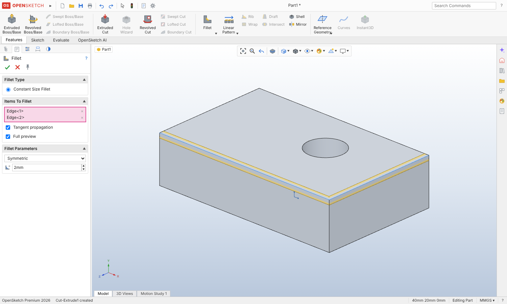

# OpenSketch

A parametric CAD app that works the way SOLIDWORKS works, built on
[build123d](https://github.com/gumyr/build123d) (OpenCascade), with an AI copilot that writes
real, editable features into the same tree you edit by hand. Think "Cursor for hardware".



This first version covers **part files**: sketches and features. Assemblies with SOLIDWORKS-style
mates come next (see Roadmap).

## Run it

```bash
pip install -e .            # build123d, fastapi, uvicorn
pip install -e ".[ai]"      # optional: the AI copilot (anthropic SDK)
export ANTHROPIC_API_KEY=... # optional
python -m opensketch         # opens http://127.0.0.1:8000
```

## What works

The layout and the click-flow follow SOLIDWORKS 2024: CommandManager tabs (Features, Sketch,
Evaluate, add-in tab), FeatureManager design tree with rollback bar, PropertyManager with green
check / red X and pink selection boxes, Heads-up View toolbar, confirmation corner, reference triad,
Task Pane on the right, status bar with Under/Fully/Over Defined and "Editing Sketch1".

**Sketch**
- Sketch on Front / Top / Right, on reference planes, or on any planar face (Normal To on entry).
- Line (click-click chains, click-drag), Centerline, Corner and Center Rectangle, Straight Slot,
  Circle, Centerpoint / 3 Point / Tangent Arc, Polygon, Point.
- Inference while sketching: endpoint merge, point on curve, midpoint, horizontal / vertical
  relations, dotted alignment guides, cursor glyphs and live length/radius readouts.
- Smart Dimension: lines (aligned / horizontal / vertical by cursor position), point-point,
  point-line, parallel lines, angle, diameter, radius. Modify box on placement and on double-click.
  Over-defining dimensions ask "Make this dimension driven?".
- Relations: Add Relations list filtered by selection (SOLIDWORKS rules), relation glyphs,
  Display/Delete Relations, drag-to-solve, box select (window / crossing).
- Blue = under defined, black = fully defined, red = over defined, from a live 2D solver with
  degrees-of-freedom and redundancy analysis.
- Trim (to closest), Sketch Fillet (keeps a virtual sharp), Convert Entities, Offset Entities,
  Mirror Entities, Repair Sketch.

**Features**
- Extruded Boss/Base and Extruded Cut: Blind, Through All, Up To Next, Mid Plane, Direction 2,
  draft, flip side to cut, merge result. Start from a sketch or pick a plane inside the command.
- Revolved Boss/Base and Revolved Cut (auto-picks the only centerline).
- Fillet, Chamfer (angle-distance, distance-distance), Shell, Mirror, Linear Pattern,
  Circular Pattern, Reference Plane.
- Live yellow previews computed by build123d; edit feature, edit sketch, suppress, rollback,
  rename (F2), delete with dependants, undo/redo for every step.

**Evaluate and files**
- Mass Properties (with material), Measure, Section View, Check (What's Wrong).
- Save / Open `.osk` (JSON), export STEP and STL, autosave in the browser.

**AI copilot** (Task Pane, or Ctrl+L)
- Describe a part or a change. Claude proposes features in the [document format](docs/DOCUMENT.md),
  the backend rebuilds them, rebuild errors go back to Claude to fix, and the proposal shows in
  purple until you Accept or Reject it. Everything stays editable: sketches come with relations and
  dimensions. Quick actions: Explain Model, Fix Errors, Fully Define.

## Mouse and keys

Middle drag rotates, Ctrl + middle pans, Shift + middle zooms, wheel zooms at the cursor
(Alt + left drag rotates on a trackpad). Space opens View Orientation, Ctrl+1..8 standard views,
F zoom to fit, arrows rotate, S opens the shortcut bar, Enter repeats the last command,
Ctrl+B rebuilds, Ctrl+Z / Ctrl+Y undo / redo. Help > Keyboard Shortcuts lists them all.

## Architecture

```
opensketch/
  geometry.py        feature-tree regen with build123d, tessellation, mass props, export
  server.py          FastAPI: /api/regen (with live preview), /api/mass, /api/export, /api/ai
  ai.py              Claude tool loop: propose_features -> rebuild -> report -> fix
  static/
    index.html, css/app.css
    js/app.js        controller: modes, selection, commands, PropertyManager flow, undo
    js/viewer.js     three.js graphics area (orthographic, SOLIDWORKS mouse)
    js/sketch/       solver.js (constraint solver), sketcher.js (tools), draw.js, geom2d.js
    js/ui/           ribbon.js, tree.js, pm.js, dialogs.js, taskpane.js
    js/features.js   PropertyManager definitions for each feature
    js/commands.js   command registry and CommandManager layout
```

The browser solves sketches (instant dragging); the server rebuilds solids. The part is plain JSON,
so the UI, the AI and files share one format.

## Tests

```bash
pytest -q                                  # regen, previews, AI loop (fake client)
node --test tests/js/solver.test.mjs       # sketch solver
```

## Roadmap

1. Assemblies: insert parts, Mate PropertyManager (coincident, parallel, perpendicular, tangent,
   concentric, distance, angle, lock, width, symmetric), mate solver, Mates folder, interference.
2. Remaining part features: Hole Wizard, Swept / Lofted, Draft, Rib, Instant3D drag handles,
   splines, sketch text, equations and global variables, configurations.
3. Stronger topological naming for fillet/chamfer edge references.
4. Drawings.

SOLIDWORKS is a trademark of Dassault Systemes. OpenSketch is not affiliated with it; the icons
are original drawings.
