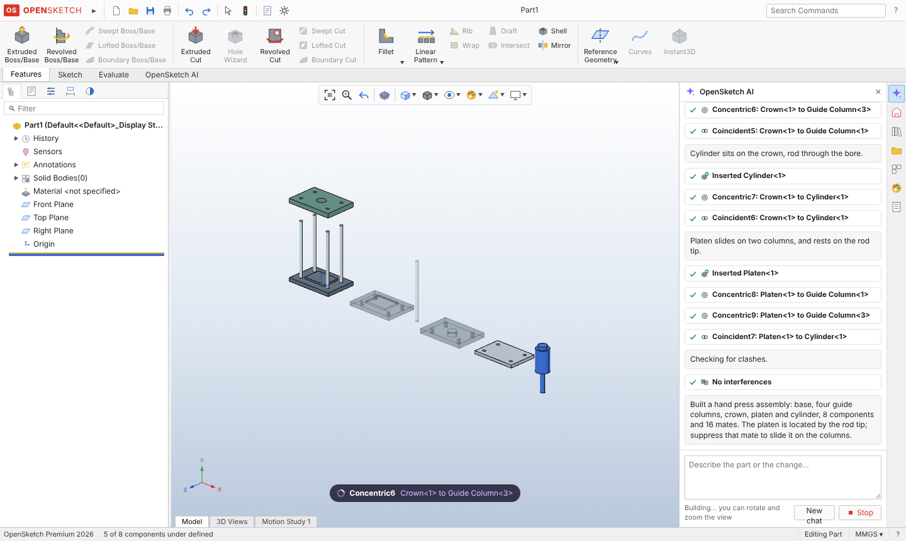
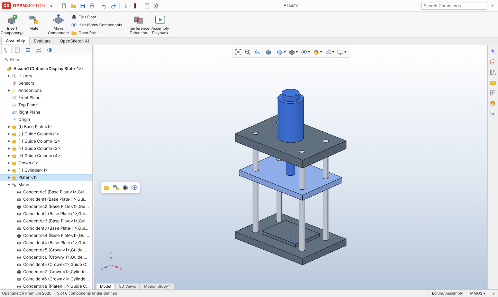
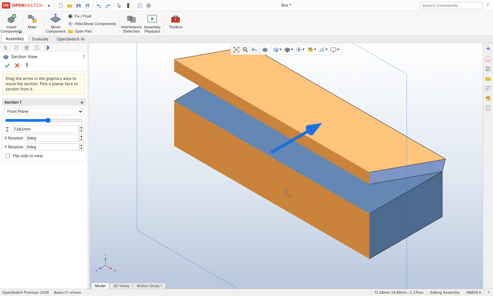
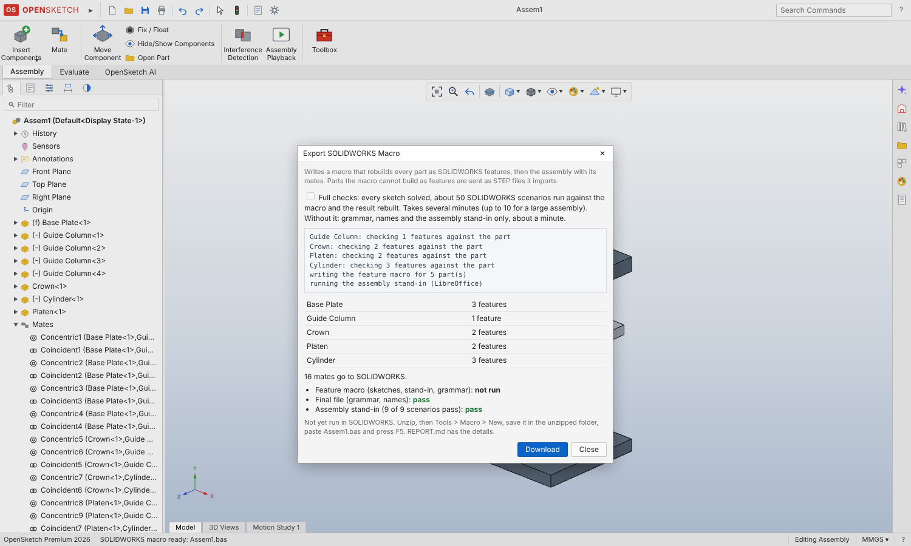

# OpenSketch

A parametric CAD app that works the way SOLIDWORKS works, built on
[build123d](https://github.com/gumyr/build123d) (OpenCascade), with an AI copilot that writes
real, editable features into the same tree you edit by hand. Think "Cursor for hardware".



Version 0.4 adds **SOLIDWORKS macro export** (File > Export SOLIDWORKS Macro): one VBA macro that
rebuilds each part in SOLIDWORKS as native, fully defined features, then inserts the components where
OpenSketch has them and adds the mates one by one, keeping a mate only if SOLIDWORKS makes it without
moving anything. Parts it cannot rebuild as features go in as STEP imports, so the assembly is always
complete. The macro is checked before you get it (see "SOLIDWORKS macro export" below).

Version 0.3 added **STEP import** (parts and assemblies, then keep editing by hand or with the AI),
**mates that move like SOLIDWORKS** (drag a hinged lid open, Hinge and limit mates), a **Toolbox** of
standard screws, nuts, washers and bearings, **Tab / Shift+Tab** hide and show, and a **Section View**
with a draggable arrow and filled cut faces.

Version 0.2 added **assemblies** (components, SOLIDWORKS-style mates, a mate solver, interference
detection) and an AI that **builds in front of you**: each part grows feature by feature while
Claude writes it, then the components fly in and settle onto their mates.

No API key? Open the AI pane (Ctrl+L) and click **Watch a demo** to see a recorded session play
through the same live view.

## Try it in the browser

[](https://codespaces.new/yuanzhengyang98/opensketch?quickstart=1)

Click the badge, then **Create codespace**. GitHub sets up a cloud machine and OpenSketch opens in
a new browser tab. The first launch takes about 3 to 5 minutes; later launches take seconds. If the
tab does not open, go to the **Ports** tab and click the globe next to port 8000.

For the AI copilot, add `ANTHROPIC_API_KEY` as a Codespaces secret
(GitHub > Settings > Codespaces > Secrets) before you create the codespace.

Stop the codespace when you are done (it also stops itself after 30 idle minutes).

The codespace keeps itself up to date: about once a minute it checks GitHub, pulls any new version of
`main` and restarts OpenSketch. The open tab then shows "OpenSketch was updated" with a Reload button
(your model is kept). There is no need to restart or recreate the codespace after an update. It skips
updating, and says why, if files were edited inside the codespace.

## Use it from Claude (MCP)

OpenSketch is also an MCP server, so Claude (in claude.ai, the desktop app or Claude Code) can build
parts and assemblies in it while you watch them appear in the browser. It uses your Claude plan, not
your Anthropic API key.

MCP work runs in the background by default. A browser is optional for interactive editing;
the server can import source CAD, build the model, return a PNG for inspection, and export files:

- `import_document(filename?, data? | upload_id?, name?)`: a file, up to 32 MiB, into a new document.
  Supports `.osk`, `.json`, STEP, EAGLE XML `.brd`, and ZIPs containing one STEP or board file. Small
  files can go as base64 `data`. For anything bigger, `request_upload(filename, size_bytes?)` gives a
  one-time link (10 minutes, one upload, your account only); send the file to it with
  `curl -sS -T model.step '<upload_url>'` (gzip with `Content-Encoding: gzip` if you like), then call
  `import_document(upload_id=...)`. The file never has to be written out as text.
- `preview_document(doc_id, view?, width?, height?, part_id?)`: a PNG image returned directly in the
  tool result. Isometric, top, front and right views work without a browser or graphics driver.
- `export_document(doc_id, format, part_id?)`: `.osk`, STEP or STL, with source version, SHA-256 and
  an artifact-specific download link valid for one hour. Exporting an assembly part uses its local
  coordinates. Downloads and previews do not change the document or create history versions.

For reliable building, Claude also gets three tools borrowed from
[SolidCraft](https://github.com/bherbruck/solidcraft):

- `batch(doc_id, steps, summary?, stop_on_warnings?, dry_run?)`: several modelling steps as one change.
  If a step is refused, adds a rebuild error or a failing mate, nothing is saved and the reply names the
  step and why. On success it is one version and one undo. `dry_run` checks without saving.
- `body_topology(doc_id, part_id?, kind?, near?, limit?)`: every face and edge with points, normals,
  axes, radii and the faces each edge joins, plus the `ref` to pass to fillet, chamfer, shell or draft.
- `inspect_design(doc_id, part_id?, sketches?)`: per-feature state and volume change, the body's volume,
  area, centre of mass and bounding box, and each sketch's degrees of freedom; for assemblies, mate and
  component states and the under-defined components.
- `measure_items(doc_id, a, b?)`: like Evaluate > Measure. Sizes, hole diameters and slot widths on a
  face, minimum distance, axis-to-axis distance, angles; between components in assembly coordinates.
- `set_parameter` / `set_equation`: global variables and equations (Tools > Equations), with sketches
  re-solved when a dimension changes. The browser has the same Equations dialog.
- `delete_items(..., dry_run)`: what a deletion takes with it and what it would break, before deleting.
- `preview_document` also takes `yaw`/`pitch`, a close-up (`target`, `view_width`) and a `section` cut.

- `publish_review(doc_id, compare_version?, title?, notes?)`: a read-only share link that works without
  the password. It opens OpenSketch itself on a frozen copy (shapes, not the feature history) with Motion
  Review: a slider for each joint with travel, solved live, what changed since an earlier version, and
  the checks (clashes and gaps through the travel, contacts that stop touching). Works on a phone. In the
  app: File > Publish Review.
- `add_contact(doc_id, a, b, joint?, from_value?, to_value?)`: two components that must touch over a
  joint's travel; the review checks it.

Faces and edges have persistent names (`e1:end|e1:side:s1L1`), so a fillet stays on its edge when the
part changes size. `skills/opensketch-cad/` is a Claude skill for working this way (predict, build a
stage, measure); `get_modelling_guide` returns its reference tables too.

STEP, STL and PNG generation reject active feature or mate errors; native `.osk` backups remain
available for documents needing repair. Warnings remain visible in the result. Rebuild reports
distinguish `rebuilt` (no errors) from `clean` (no errors or warnings), and include resolved sketch
planes, feature bounds and material changes. Use a `fixed` coordinate plane or offset datum when
a computed pocket or pin height must stay exact; `face` planes deliberately follow nearby faces.
See the [plane contract](docs/DOCUMENT.md#conventions).

1. **Set a password.** On GitHub: Settings > Codespaces > Secrets > New secret, name
   `OPENSKETCH_PASSWORD`, give this repository access. Restart the codespace once so it picks it up.
   Without a password, anyone with the address could use your OpenSketch.
2. **Make the port public.** In the codespace, open the Ports tab, right-click port 8000, Port
   Visibility > Public. Claude cannot reach a private port. (The first visit asks you to create your
   account, with the password as the key.)
3. **Open Connect AI.** In OpenSketch: OpenSketch AI tab > Connect AI (or File > Connect AI). The "Your AI
   app" tab has the address and the exact steps for ChatGPT, Claude, Claude Code, Codex, Cursor, VS Code,
   Gemini CLI and any other MCP app (one-click buttons for Cursor and VS Code). The address contains the
   key; keep it private. Each account gets its own address, which reaches only that person's Files.
4. **Add it to your AI app.** For example in Claude: Customize > Connectors > Add custom connector, paste
   the address, choose No sign-in. In ChatGPT (paid plans, developer mode on): chatgpt.com/plugins > + >
   Add custom MCP server, Server URL, No authentication.
5. **Use it.** In a chat, turn OpenSketch on and ask, for example: "In OpenSketch, design a wall bracket
   for a 20 kg shelf using off-the-shelf screws." Open the link it gives you.

The model updates in the page within a second or two of each change Claude makes, and your own edits in
the page are saved back so Claude sees them. If you both change it at once, the page asks which version
to keep. The server keeps the last 50 versions of each document (you and your AI can undo or restore them),
in `~/opensketch-data` in the codespace. The Files page lists them.

The codespace has to be running for Claude to reach it: it stops after 30 idle minutes, so open it
before you use Claude with it.

## Accounts and sign-in

OpenSketch uses accounts (email and password). The first time you open a server that has
`OPENSKETCH_PASSWORD` set, it asks you to create the owner account, with that password as the key that
proves you own the server. After that everyone signs in with their own email and password.

- Your avatar (top right) has Account settings (name, password), Invite people (a link that works once and
  lasts 7 days), People on this server (remove someone), the look switch and Sign out.
- Forgot your password? On the sign-in page, Forgot your password? resets it with the server password.
- A server without `OPENSKETCH_PASSWORD` (a private codespace) stays open until you create an owner account
  from the avatar menu.
- Claude's connector address does not change when you add accounts. Published review links still work
  without signing in.

## Files

Everything you save lives in Files (the Files button next to the logo, File > Open or Ctrl+O): a picture of
each model, search, sort, grid or list, rename (F2), duplicate, download as .osk, version history (restore any
of the last 50 versions) and a Trash that keeps deleted files for 30 days. New part / New assembly start a file
straight in Files; Upload (or drag files onto the page) brings in .osk, STEP, EAGLE .brd or a .zip. A file in
Files saves itself as you work (the title bar shows Saved / Saving); a model that is only in your browser shows
Draft, and Ctrl+S puts it in Files. Pictures come from your browser when you save; files your AI made without
a browser get a picture drawn on the server. Each person sees only their own files (the server owner also sees
files made before accounts existed).

## Install it as an app

OpenSketch is an installable web app: in Chrome or Edge click Install in the address bar (Mac: also Safari >
File > Add to Dock). It installs for your user only (no admin rights), opens in its own window, starts on the
model you had open, and opens .osk and STEP files from your computer. Updates arrive by themselves.

## Your own AI key

Connect AI > Built-in AI. Pick a provider (Claude, OpenAI, Gemini, OpenRouter for many other models, or any
OpenAI-compatible address), click Get a key to open the provider's key page, and paste the key: OpenSketch
recognises the provider from the key, checks it at once and lists the models it can use. Choose one and Save
and use. The key is stored encrypted on your account and used only for
your requests; the app never shows it again (only its last four characters). Web search and page reading work
with Claude only. If the server has its own `ANTHROPIC_API_KEY`, people without a key of their own use that
one (set `OPENSKETCH_SHARE_SERVER_KEY=0` to stop sharing it).

## Sign in with Google (optional)

Everything happens in the browser. Sign in as the owner, then avatar menu > Sign in with Google. The dialog
walks you through it and shows the exact address to give Google:

1. Open Google Auth Platform (console.cloud.google.com/auth/overview), pick or create a project, and click
   Get started if it is new: app name OpenSketch, your email, audience External.
2. In Audience, click Publish app (OpenSketch only asks for name and email, so Google does not need to review
   it), or keep it in testing and add yourself as a test user.
3. In Clients, click Create client, choose Web application, and add the redirect address from the dialog
   (for example `https://opensketch-yz.fly.dev/auth/google/callback`) under Authorized redirect URIs. Create.
4. Paste the Client ID and Client secret into the dialog and click Turn on. OpenSketch asks Google whether
   it knows the client before saving, and keeps the secret encrypted on the server.

The sign-in page then shows Continue with Google. Your own account links itself the first time if it is a
Gmail address (or a Google Workspace account on its own domain); otherwise sign in with your password. New
people need an invite link (Join with Google), unless you turn on "Anyone can create an account" in avatar
menu > People on this server. Server admins can instead set `GOOGLE_CLIENT_ID` and `GOOGLE_CLIENT_SECRET`
(the deploy workflow stages them from GitHub secrets of the same names); those win over the app setting.

## Design panel and Ask AI

Click a face, a feature, a sketch, a component or a mate and the Design panel (right) shows the numbers that
shape it: sketch dimensions, depths, radii, counts, mate distances and global variables. Drag a label left
or right (Shift faster, Alt finer), drag the slider, or type a value: the sketch dimension itself changes,
the sketch is re-solved and the model rebuilds as you drag. One change is one undo step. For a face, the
feature that made it comes first and the numbers that shape that face are marked. Close the panel with its
x and it stops opening by itself; click its icon to bring it back.

Ask AI (bottom of the panel, or the AI chat with the "About" chip) sends your request with the selection,
so "make this 5 mm thicker" or "round these edges" acts on what you picked.

The look follows Linear (dark by default, warm greys, Inter, small monochrome icons, indigo accent, quiet
side panels so the model leads); the layout and every command work the SOLIDWORKS way. Avatar menu or
View > Theme: Dark, Light, or Classic (SOLIDWORKS colours). Ctrl+K jumps to command search.

## Host it on Fly.io (optional, when you need it)

The codespace is free but only reachable while it is open. To have OpenSketch always reachable at a fixed
address (for example so Claude can use it any time), host it on Fly.io: about US$3 to 8 a month for one
person, because the server stops when idle and wakes on the next request (the first one after a break
takes a few seconds). Everything is set up already; it is all browser steps:

1. Sign up at fly.io and add a card.
2. In the Fly dashboard, open Tokens and create an organization token for your personal organization.
   Copy it.
3. On GitHub, in this repository: Settings > Secrets and variables > Actions > New repository secret.
   Add `FLY_API_TOKEN` (the token), `OPENSKETCH_PASSWORD` (required: the key for creating the owner
   account and resetting passwords) and, for the
   built-in AI chat, `ANTHROPIC_API_KEY`.
4. Open the Actions tab, choose Deploy to Fly.io, Run workflow. The first run creates the app and its
   storage and takes about 10 minutes; after that every push to main deploys by itself.
5. OpenSketch is then at `https://opensketch-yz.fly.dev`. If Fly says the name is taken, add a repository
   variable `FLY_APP` (same Settings page, Variables tab) with another name, and run it again.
6. In that OpenSketch, open Connect AI and update the connector in your AI app with the new address.

Your own domain (optional): in the Fly dashboard open the app, Certificates, Add certificate, and enter a
subdomain such as `cad.example.com`. Add the CNAME record Fly shows at your domain's DNS provider (plus the
`_acme-challenge` CNAME if it asks). When the certificate shows Issued, add a repository variable `PUBLIC_URL`
= `https://cad.example.com` (Settings > Secrets and variables > Actions > Variables) and run the Deploy
workflow once, so share links and Claude's connector address use the new domain. The `.fly.dev` address keeps
working.

The Fly server and the codespace are separate: models saved on one are not on the other (move one with
Files > Download .osk, then Upload on the other).

## Run it locally

```bash
pip install -e .            # build123d, fastapi, uvicorn
pip install -e ".[ai]"      # optional: the AI copilot (anthropic SDK)
export ANTHROPIC_API_KEY=... # optional
python -m opensketch         # opens http://127.0.0.1:8000
python -m opensketch --no-browser # background server for MCP, no browser launch
OPENSKETCH_AI_DEMO=1 python -m opensketch   # every AI request plays the recorded demo
```

## What works

The layout and the click-flow follow SOLIDWORKS 2024: CommandManager tabs (Features, Sketch,
Evaluate, add-in tab), FeatureManager design tree with rollback bar, PropertyManager with green
check / red X and pink selection boxes, Heads-up View toolbar, confirmation corner, reference triad,
Task Pane on the right, status bar with Under/Fully/Over Defined and "Editing Sketch1".

**Sketch**
- Sketch on Front / Top / Right, on reference planes, or on any planar face (Normal To on entry).
- Line (click-click chains, click-drag), Centerline, Corner and Center Rectangle, Straight Slot,
  Circle, Centerpoint / 3 Point / Tangent Arc, Polygon, Point.
- Inference while sketching: endpoint merge, point on curve, midpoint, horizontal / vertical
  relations, dotted alignment guides, cursor glyphs and live length/radius readouts.
- Smart Dimension: lines (aligned / horizontal / vertical by cursor position), point-point,
  point-line, parallel lines, angle, diameter, radius. Modify box on placement and on double-click.
  Over-defining dimensions ask "Make this dimension driven?".
- Relations: Add Relations list filtered by selection (SOLIDWORKS rules), relation glyphs,
  Display/Delete Relations, drag-to-solve, box select (window / crossing).
- Blue = under defined, black = fully defined, red = over defined, from a live 2D solver with
  degrees-of-freedom and redundancy analysis.
- Trim (to closest), Sketch Fillet (keeps a virtual sharp), Convert Entities, Offset Entities,
  Mirror Entities, Repair Sketch.
- Offset Entities accepts lines, arcs and circles, including converted outlines. Select curves
  before or after opening the command, set Distance, and inspect the preview before accepting.
  Select chain follows connected endpoints; turn it off for individual curves. Reverse switches
  sides (closed contours expand by default). Invalid or collapsed offsets show an error. Results
  are editable sketch copies; there is no persistent offset-distance relation to the source.

**Features**
- Extruded Boss/Base and Extruded Cut: Blind, Through All, Up To Next, Mid Plane, Direction 2,
  draft, flip side to cut, merge result. Start from a sketch or pick a plane inside the command.
- Revolved Boss/Base and Revolved Cut (auto-picks the only centerline).
- Swept Boss/Base and Swept Cut: one closed profile sketch and a separate connected path sketch.
- Lofted Boss/Base and Lofted Cut: two or more ordered closed sections; optional ruled surfaces.
- Hole Wizard: explicitly dimensioned simple, counterbore and countersink holes; Blind or Through All,
  plane/face selection, X/Y position and reverse direction. No threads or fastener-standard presets.
- Fillet, Chamfer (angle-distance, distance-distance), Shell, Mirror, Linear Pattern,
  Circular Pattern, Reference Plane.
- Live yellow previews computed by build123d; edit feature, edit sketch, suppress, rollback,
  rename (F2), delete with dependants, undo/redo for every step.

**Evaluate and files**
- Mass Properties (with material), Measure, Section View, Check (What's Wrong).
- Save / Open `.osk` (JSON), export STEP and STL, autosave in the browser.
- Exports reject active feature rebuild errors instead of silently exporting an incomplete body.
  Suppressed and rolled-back features remain intentionally excluded.

**Assemblies** (File > New > Assembly, or ask the AI for a multi-part product)



- One `.osk` file holds the assembly and its parts ([format](docs/DOCUMENT.md#assembly-document)).
- Assembly CommandManager: Insert Components (parts in the file, Browse for a part file, or New
  Part), Mate, Move Component, Fix / Float, Hide/Show, Open Part, Interference Detection,
  Assembly Playback.
- Standard mates: Coincident, Parallel, Perpendicular, Concentric, Lock, Distance, Angle, with
  Aligned / Anti-Aligned. The Mate PropertyManager previews live and stays open for the next mate.
- Mate solver (damped least squares over each free component's six degrees of freedom) moves
  components as little as possible. The tree shows (f) fixed and (-) under defined, as SOLIDWORKS
  does; mates that cannot be satisfied turn red.
- Drag an under-defined component with the left mouse button: the mates keep holding, so a platen
  slides along its columns.
- Open Part edits a component's part in place; Return to Assembly brings the change back as one
  undo step, and mates follow the faces that moved.
- Motion Study 1 (bottom tab) replays the assembly order: each component flies in and settles.
- Interference Detection lists overlapping pairs with their volume and shows the clash in red.
- STEP / STL export of the whole assembly, mass properties with each part's own material.

**Import and Toolbox**
- Open an EAGLE XML `.brd`, including the official Arduino UNO CAD ZIP, as an editable PCB outline,
  thickness extrusion and mechanical-hole cuts. Signed arcs and the board's layer stack are used;
  missing stack data is reported with a 1.6 mm default. Component placements and 2D package data
  are preserved as metadata. Component bodies, copper traces and plated pad/via drills are not
  generated. Archives with several supported models ask you to select a file explicitly.
- Open or drop a STEP file, or the .zip a supplier like McMaster-Carr sends it in. One body becomes a part with an `Imported1` feature you can keep adding
  cuts, fillets and shells to. Several bodies become an assembly, identical bodies sharing one part.
  OpenSketch AI > **Rebuild as Features** turns an imported body into an editable feature tree and
  checks the volume against the import; **Add Mates** mates an imported assembly from its geometry.
- SOLIDWORKS files (.sldprt, .sldasm) are a closed format: save them as STEP in SOLIDWORKS first.
- Toolbox (Design Library pane, or Assembly > Toolbox): ISO screws, nuts, washers and ball bearings,
  made to size. The AI uses it too, and for bought parts it gives you the McMaster-Carr number to
  download; drop the STEP on its card and it replaces the placeholder.

**Motion and viewing**
- Drag any component by any point: it follows the mouse within its mates, so a hinge turns and a
  slider slides. Hinge mate (Mechanical Mates), Limit Distance and Limit Angle (Advanced Mates).
- Coupler mate (Mechanical Mates): one part drives another by a motion law, a table of driver and
  driven values (a dwell, then a pickup) or a ratio. Turn a lever and its lock tongue follows. Its
  PropertyManager shows the law as a chart, adds the current position as a point, and can add a
  Contact Check (the two parts must touch over part of the travel).
- Evaluate > Motion Review: a slider and Play for each joint with travel, solved in the browser, and
  checks from the server: clashes and the smallest gap through each joint's travel, joints that do not
  reach their limits, contacts that stop touching. Click a problem to go to that pose with the two
  parts in red. Publish Review shares the same view read-only.
- Tab hides the component under the cursor, Shift+Tab shows hidden ones there.
- Section View: Front / Top / Right or a picked face, offset slider, X / Y rotation, a blue arrow to
  drag in the graphics area, filled cut faces. Works in parts and assemblies.



**AI copilot** (Task Pane, or Ctrl+L)
- Describe a part, a change, or a whole product. For one piece, Claude writes features in the
  [document format](docs/DOCUMENT.md). For a product with several pieces, Claude builds an assembly
  the way a SOLIDWORKS user would: create each part, insert components, add mates, check
  interference. Rebuild and solver results go back to Claude so it can fix its own errors.
- Live build view: the reply streams in (thinking summary, one sentence per step, a row per tool
  call with features ticking off). In the graphics area each part is built on a shelf beside the
  assembly: the sketch appears in blue, then the new material grows out of the sketch plane. Each
  inserted component flies from the shelf to its place, and each mate slides the components into
  position. You can rotate and zoom while it works; Stop cancels.
- Off-the-shelf first: Claude uses standard and bought parts wherever it can (Toolbox screws, nuts,
  washers and bearings; catalogue parts such as motors, hinges and gas springs with a real part
  number for you to download) and only designs custom parts for what is specific to your product.
- Web: Claude can search the web and read pages and PDFs (datasheets, standards, part sizes). Each
  search shows as a row in the chat and the sources are listed under the reply. Searches cost
  US$10 per 1,000 on your Anthropic account, at most 5 per request. Set `OPENSKETCH_AI_WEB=0` to
  turn it off.
- The result shows in purple until you Accept or Reject it. Everything stays editable: sketches come
  with relations and dimensions, components with real mates. Quick actions: Explain Model / Assembly,
  Fix Errors, Fix Mates, Fully Define.

## SOLIDWORKS macro export



File > Save As > SOLIDWORKS Macro (or File > Export SOLIDWORKS Macro) writes a zip: `<Name>.bas`,
`steps/` for parts sent as STEP, and `REPORT.md`. In SOLIDWORKS 2022: Tools > Macro > New, save it
in the unzipped folder, paste the `.bas` and press F5. Parts and the assembly are saved in
`Documents\OpenSketch\<Name>`; the log goes to `%TEMP%\<Name>_log.txt`.

- **Parts as features.** Extrudes and cuts along one direction (blind, through all, mid plane, two
  directions, draft), with lines and arcs in their sketches, then fillets and 45 degree chamfers, and
  linear / circular patterns and mirrors of extrudes, are rebuilt by the sldmacro engine
  (`opensketch/vendor/sldmacro`): every sketch fully defined by relations and dimensions, every
  feature measured after it is made and redone if SOLIDWORKS read a flag the other way.
- **Parts as STEP.** Revolves, sweeps, lofts, Hole Wizard features, shells, features in a second direction, imported bodies and Toolbox
  parts go in as STEP imports. The report says which and why.
- **Assembly.** Components start where OpenSketch's solver put them. Coincident, concentric,
  parallel, perpendicular, distance, angle, lock, hinge (concentric + coincident + angle limits) and
  limit mates are added on the same faces, planes and axes. Axes with no round face get a reference
  axis (two standard planes, or a straight edge).
- **Checks before you get it.** Each part's features are compared with the OpenSketch solid; the
  engine checks every sketch with a solver, runs the macro against mock SOLIDWORKS objects (about 50
  scenarios) and parses it with a VBA grammar; an assembly stand-in runs the mate code against mocks
  that hold the parts' real faces (9 scenarios). Nothing here runs SOLIDWORKS itself: send back the
  log after the first run.
- The checks need a toolchain (LibreOffice, Java, a sketch solver). Codespaces installs it in the
  background the first time; locally run `bash opensketch/vendor/sldmacro/scripts/setup_env.sh`.
  Without it every part goes as STEP and the report says which checks did not run.

## Mouse and keys

Middle drag rotates, Ctrl + middle pans, Shift + middle zooms, wheel zooms at the cursor
(Alt + left drag rotates on a trackpad). Space opens View Orientation, Ctrl+1..8 standard views,
F zoom to fit, arrows rotate, S opens the shortcut bar, Enter repeats the last command,
Ctrl+B rebuilds, Ctrl+Z / Ctrl+Y undo / redo. Help > Keyboard Shortcuts lists them all.

## Architecture

```
opensketch/
  geometry.py        feature-tree regen with build123d, tessellation, mass props, export
  assembly.py        assemblies: part cache, mate solver, interference, export
  server.py          FastAPI: /api/regen (parts and assemblies), /api/mass, /api/interference,
                     /api/export, /api/export/sldmacro (background job), /api/ai/stream (NDJSON events)
  ai.py              streaming Claude tool loop: propose_features, create_part, insert_component,
                     add_mate, delete_items, check_interference; rebuilds each feature as it arrives
  demo.py            recorded sessions (hand press, L bracket) for "Watch a demo" and tests
  importer.py        STEP import (parts, assemblies), embedded BREP bodies, Toolbox parts (bd_warehouse)
  eagle.py           EAGLE XML PCB import with editable outline/thickness/holes and source metadata
  preview.py         browser-free orthographic PNG renderer with depth buffer and bounded raster work
  artifacts.py       immutable MCP exports and previews, signed expiring download links
  inspection.py      MCP body_topology and inspect_design (sketch DOF via js/sketch/solve_cli.mjs)
  measure.py         Measure one or two picks (sizes, holes, slots, distances, angles)
  params.py          global variables and equations (safe expression evaluator, sketch re-solve)
  naming.py          persistent face and edge names (how each face was made)
  edits.py           deleting features: what goes with them and what would break
  review.py          review pages: solved joint travel, checks, version compare, share links
  templates/review.html  the review page (YZ Default design system)
  sldexport.py       SOLIDWORKS macro export: part -> engine recipe, assembly data, checks, zip
  sldexport_vba.py   the VBA OpenSketch adds to the macro (STEP import, saving, components, mates)
  sldexport_standin.py, sldexport_mock/   assembly stand-in (LibreOffice Basic mocks of SOLIDWORKS)
  vendor/sldmacro/   the sldmacro engine (vendored, unchanged; see PROVENANCE.md)
  static/
    index.html, css/app.css
    js/app.js        controller: modes, selection, commands, PropertyManager flow, undo
    js/asm.js        assembly mode: tree, Mate PM, drag, Open Part, playback, interference
    js/live.js       live build view: shelf, sketch-then-grow, fly-in, mate slides, pacing
    js/section.js    Section View: plane, offset, rotations, drag arrow (caps drawn in viewer.js)
    js/toolbox.js    Toolbox pane and editing Toolbox parts
    js/viewer.js     three.js graphics area (orthographic, SOLIDWORKS mouse, components, tweens)
    js/sketch/       solver.js (constraint solver), sketcher.js (tools), draw.js, geom2d.js
    js/ui/           ribbon.js, tree.js, pm.js, dialogs.js, taskpane.js
    js/features.js   PropertyManager definitions for each feature
    js/commands.js   command registry and CommandManager layout
```

The browser solves sketches (instant dragging); the server rebuilds solids. The part is plain JSON,
so the UI, the AI and files share one format.

## Tests

```bash
pytest -q                                  # regen, previews, mate solver, streaming AI (fake client), demos,
                                           # macro export (engine and stand-in tests skip without the toolchain),
                                           # reference parts (tests/reference_parts: hand-worked volume,
                                           # centre of mass and bounding box for 14 parts), parameter
                                           # sweeps, and the action matrix (fillet/chamfer/shell/draft on
                                           # every edge and face of 20 parts against a saved baseline)
npm ci                                    # dev-only DOM test dependency; Node >=20.6
npm test                                  # sketch solver, offset, document history, command and DOM regressions
```

The [2026-10-16 review](docs/CODE_REVIEW_2026-10-16.md) records reproduced bugs, fixes,
new-feature usage, UX recommendations and validation limits.

## Roadmap

1. Run the exported macros in SOLIDWORKS and fix what the logs show; then revolves and holes across
   the main direction as features instead of STEP.
2. Assemblies: tangent, width and symmetric mates, gear and slot mates, sub-assemblies, exploded
   views, mate references picked from vertices and circular edges.
3. Remaining part features: hole threads and standard presets, sweep/loft guide curves and advanced
   controls, Rib, Instant3D drag handles, splines, sketch text, configurations.
4. Persistent names from OpenCascade history (exact, instead of matched by geometry).
5. Drawings.

SOLIDWORKS is a trademark of Dassault Systemes. OpenSketch is not affiliated with it; the icons
are original drawings.
