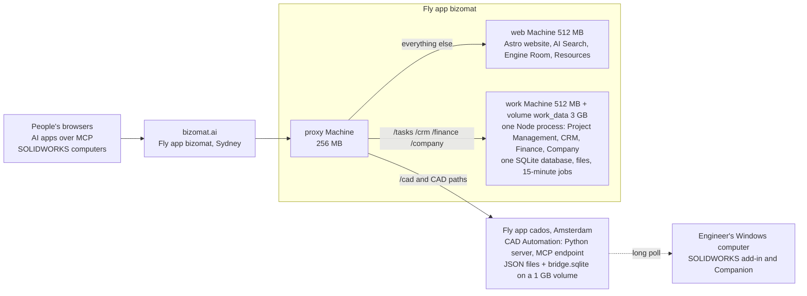
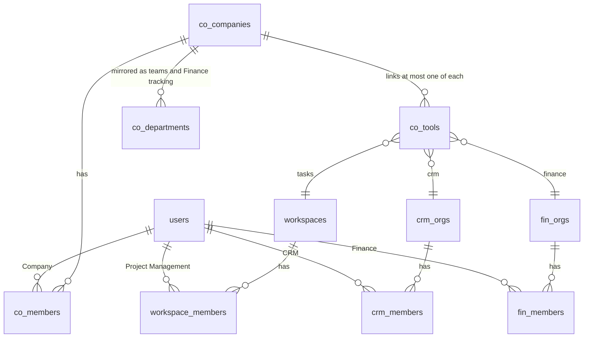

# 1. Existing system discovery report

Status: findings from a read-only inspection of the repository on 13 Nov 2026 (`main` at `5c15949`, Finance Stage 1
deployed in run 22). Detail and file references: `../discovery/work-app.md`, `../discovery/cad-automation.md`,
`../discovery/website-and-infrastructure.md`. Production facts come from the repository (`fly.website.toml`, read from
Fly on 9 Nov 2026; `docs/SITE-CAD-INTEGRATION.md`); this session could not reach Fly.io directly.

## 1.1 The platform at a glance

| Fact | Value |
| --- | --- |
| Repository | `kevinjogin/bizomat-site` (website, `apps/work`, `apps/cad` as a pinned copy, infrastructure) |
| Production | Fly app `bizomat` (three Machines: proxy, web, work) and Fly app `cados` (CAD Automation) |
| Signed-in applications | Project Management (`/tasks`), CRM (`/crm`), Finance (`/finance`), Company (`/company`): one Hono app with a React SPA, four mounts |
| Database | One SQLite file for all four (`/data/work/db.sqlite`), 15 migrations, 144 tables, 194 indexes, 6 triggers (all on the Finance ledger); D1 in tests and in the (not deployed) Cloudflare plan |
| CAD Automation | Separate repository (`kevinjogin/bizomat-cad`) and app; its own accounts; MCP with 31 tools; models stay on the engineer's computer |
| Website | Astro, static pages with hashed scripts, AI Search over a static index, Engine Room, Resources (tools and Library) |

## 1.2 Routes and entry points

| Entry | Served by | Notes |
| --- | --- | --- |
| `bizomat.ai/` and public pages | web | Static Astro build; `/api/discover` for AI Search |
| `/tasks/...` | work | Project Management SPA and `/tasks/api/...` |
| `/crm/...`, `/finance/...`, `/company/...` | work | Same app; `mount.ts` removes the prefix, so all mounts share one `/api` |
| `/finance/view/<kind>/<id>?k=` | work | Signed-out document links (Finance Stage 1) |
| `/company/authorize`, `/company/api/id/*` | work | BIZOMAT sign-in provider for other apps (OAuth code with PKCE) |
| `/cad/...`, `/mcp`, `/oauth/*`, `/.well-known/...` | cados | CAD Automation pages, MCP endpoint, OAuth for MCP clients |
| `/tasks/admin`, `/crm/admin`, `/finance/admin` | work | Platform admin consoles (404 for everyone else) |

API groups (detail in `work-app.md` section 2): `/api/*` (Project Management), `/api/crm/orgs/:org/*`,
`/api/fin/orgs/:org/*`, `/api/company/*` (including `/api/company/links/*`), `/api/admin/*`, public `/api/*-public/*`.

## 1.3 Tenancy and organisation relationships

- Each tool has its own tenant and membership table; Finance tenants are personal, household or business.
- A company (`co_companies`) links one tenant of each tool through `co_tools` and writes each person's tool roles into
  the tools' member tables (`company/sync.ts`). Links between tools are plain id columns, checked by the server.
- People can still use a tool without a company (the tools keep working standalone).

## 1.4 Authentication

- One `users` table, one HttpOnly session cookie written for all four mounts, a one-time "carry" redirect for older
  cookies, CSRF token plus Origin check on every unsafe request.
- Email confirmation and sign-up protection on; Google sign-in exists but is off in production.
- Personal API tokens (`wos_`): no scopes, act as the person in every product.
- BIZOMAT sign-in provider (OAuth code with PKCE, opaque tokens, no ID token or refresh token) for other BIZOMAT apps;
  its client list (`BIZOMAT_ID_CLIENTS`) cannot currently reach the app on Fly (finding F1 below).
- CAD Automation has its own accounts (email and password, optional Google) and OAuth 2.1 for MCP clients; it cannot
  yet accept BIZOMAT accounts.

## 1.5 Permissions (four models, all checked on the server)

| Tool | Model |
| --- | --- |
| Project Management | Workspace role (six), then project access level with seven capabilities, then grants on single tasks |
| CRM | Six roles; per module all, own or none scopes; custom role settings |
| Finance | Six roles; per module scopes and actions; approval settings; business-only features |
| Company | Owner, admin or member, plus a role in each tool |
| CAD Automation | Owner, member, tester; everything is per person (no organisations) |

## 1.6 Existing integration points

| Integration | Where |
| --- | --- |
| One customer record (CRM company ↔ Finance contact) | `company/links.ts`, `co_customer_links` |
| Won deal → draft invoice; deal → quote; deal → project | `company/links.ts`, `co_deal_links`, `fin_quotes.crm_deal_id` |
| Project costs and budget from Finance | `co_project_links`, Finance tracking projects |
| CRM activity → Project Management task | CRM routes |
| Finance quote steps on the CRM deal timeline | `fin/sales.ts` (`dealEventStmt`) |
| Company overview totals per tool | `company/summary.ts`, `overview.ts` |
| BIZOMAT sign-in for CAD Automation | provider side only |
| Website → apps | Sign in menu and product pages link to the apps |

Not yet shared: notifications (one table per tool), audit (five tables), search (per tool, `LIKE` only, nothing
across tools), invitations (four tables), teams (three systems).

## 1.7 Fly.io resources

| Resource | Size | Notes |
| --- | --- | --- |
| proxy Machine | shared-cpu-1x, 256 MB | Routes by path and host |
| web Machine | shared-cpu-1x, 512 MB | Website and AI Search |
| work Machine | shared-cpu-1x, 512 MB | All four signed-in products, one Node process, no swap |
| Volume `work_data` | 3 GB, auto-extend to 20 GB | Database, files, up to five pre-migration copies |
| cados | separate app, Amsterdam, suspends when idle | CAD Automation; 1 GB data volume |
| Deploy | `bizomat-deploy.yml` by hand (`confirm` = `DEPLOY`), preflight refuses Machine changes, volume snapshot first, rolling, public checks | Work is offline 10 to 60 seconds per deploy |

## 1.8 Findings that matter for ERP

| # | Finding | Impact | Source |
| --- | --- | --- | --- |
| F1 | `ABR_GUID` and `BIZOMAT_ID_CLIENTS` never reach the work app on Fly (the entrypoint's allow-list and the Node config pass neither) | The ABN register lookup and BIZOMAT sign-in for CAD cannot be switched on as `docs/company/README.md` says; every new ERP setting must be added in both places | `infrastructure/fly/entrypoint.sh`, `apps/work/src/node/config.ts` |
| F2 | One Node process, one SQLite writer, synchronous queries | A long ERP report or import pauses all four products; ERP must page, stream and batch | `work-app.md` 9, `website-and-infrastructure.md` 8 |
| F3 | Fixed CHECK lists (`fin_journals.source_type`, `fin_docs.kind`, `fin_statement_lines.matched_type`, `co_tools.app`) cannot widen without a table rebuild | ERP extends with new tables and nullable columns (`fin_journals.origin`), never by widening them | `work-app.md` 3.7 |
| F4 | No live memory, CPU or database size is recorded | Capacity must be measured before the stock and manufacturing stages | `website-and-infrastructure.md` 8.10 |
| F5 | CAD Automation is per person, MCP only, models on the engineer's computer, in another region, suspends when idle | Drawing generation from ERP acts for the engineer and needs CAD's BIZOMAT sign-in first | `cad-automation.md` 8, 10 |
| F6 | 80 places build `IN (...)` lists; only one splits them for D1's parameter cap | A risk only on Cloudflare (not deployed); ERP code should batch lists | `work-app.md` 9 |
| F7 | Core concepts are duplicated across tools (customers, teams, invitations, notifications, audit) | ERP's shell and My Work read them all; consolidation is a later Core project, not a precondition | `work-app.md` 7, 9 |
| F8 | Operations documents describe an older four-group plan with CAD inside `bizomat` | Plan from `fly.website.toml`, `bizomat-deploy.yml` and `CLAUDE.md` | `website-and-infrastructure.md` 9 |
| F9 | Open sign-up is on for the app that would hold ERP data | Company and module checks must hold for any new account | `fly.website.toml` |
