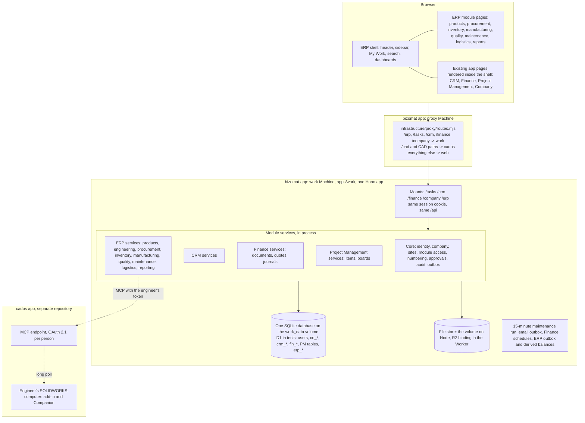

# 3. Proposed modular ERP architecture

Status: proposal for review. Decision in one line: **ERP is a fifth mount of the existing work application**
(`/erp`, beside `/tasks`, `/crm`, `/finance` and `/company`), with its own route table, screens and `erp_*` tables in
the same database, calling the existing modules' services. No new Fly app, Machine, server, database or sign-in.

## 3.1 Why this shape

| Option | Verdict | Reason |
| --- | --- | --- |
| A. New mount of the work app (`/erp`), new `erp_*` tables in the same database | **Chosen** | The CRM, Finance, Project Management and Company already share one process, one database, one session and one deployment; cross-module writes are in-process calls with the owners' own checks; joins for reports are local; nothing new to run or pay for |
| B. A separate ERP app or Fly Machine with its own database | Rejected | Forbidden by the brief; duplicates users, organisations and customers; needs a distributed integration layer and a second backup regime |
| C. ERP pages in the Astro website | Rejected | The website is public and static by design (CSP hashes, no session); the signed-in apps live in the work app |
| D. Embed existing apps with iframes | Rejected | Every app sends `X-Frame-Options: DENY` and `frame-ancestors 'none'`; iframes would weaken that, duplicate shells and break focus and history |

## 3.2 Layers

## 3.3 Module boundaries

| Module | Code (proposed) | Tables | Owns | Calls |
| --- | --- | --- | --- | --- |
| Core | `src/worker/company/` (extended) | `co_*`, `id_*`, `users`, `sessions` | identity, company, legal entities, sites, members, module access, role templates, numbering service, approvals engine, audit view, outbox | - |
| CRM | `src/worker/crm/` (unchanged) | `crm_*` | customers, contacts, leads, deals, activities | Core |
| Finance | `src/worker/fin/` (+ `postJournal` service, `origin` column) | `fin_*` | ledger, documents, quotes, payments, tax | Core |
| Project Management | `src/worker/routes`, `services/` (unchanged) | PM tables | projects, tasks | Core |
| ERP Products & Engineering | `src/worker/erp/products/`, `engineering/` | `erp_products`, `erp_revisions`, `erp_boms`, `erp_routings`, `erp_changes`, `erp_cad_links` | product master, BOMs, revisions, changes | Core, CRM (product link), Finance (line product), CAD (MCP) |
| ERP Procurement | `src/worker/erp/procurement/` | `erp_supplier_profiles`, `erp_requisitions`, `erp_rfqs`, `erp_po_extensions` | requisitions, RFQs, procurement data of POs | Finance (`createDoc` for POs, bills), Inventory |
| ERP Inventory | `src/worker/erp/inventory/` | `erp_warehouses`, `erp_locations`, `erp_stock_moves`, `erp_stock_balances`, `erp_lots`, `erp_goods_receipts` | stock and its movements | Finance (`postJournal`) |
| ERP Sales & Logistics | `src/worker/erp/sales/`, `logistics/` | `erp_sales_orders`, `erp_deliveries`, `erp_shipments`, `erp_carriers` | orders, deliveries, shipments | Finance (quotes, invoices), CRM (events), Inventory |
| ERP Manufacturing | `src/worker/erp/manufacturing/` | `erp_work_orders`, `erp_wo_operations`, `erp_work_centres` | production | Inventory, Finance (WIP), Project Management (tasks) |
| ERP Quality | `src/worker/erp/quality/` | `erp_inspection_plans`, `erp_inspections`, `erp_ncrs`, `erp_capas` | quality records | Inventory (quarantine), Project Management (actions) |
| ERP Maintenance | `src/worker/erp/maintenance/` | `erp_assets`, `erp_maintenance_plans`, `erp_maintenance_orders` | assets and upkeep | Inventory (parts), Finance (fixed assets later) |
| ERP Reporting | `src/worker/erp/reports/` | none (reads) | enterprise reports | every module's read services |

Rule enforced by a test: code under `src/worker/erp/` never names another module's tables in SQL; it imports that
module's service.

## 3.4 Client architecture

- `src/client/App.tsx` gains `IS_ERP` (as `IS_CRM`, `IS_FINANCE`, `IS_COMPANY`): the shared sign-in pages, then
  `ErpRoutes` (lazy chunk).
- `src/client/erp/`: shell, navigation, My Work, search, dashboards and module pages, built from the reusable patterns
  (`docs/erp/ux/05-reusable-screens.md`) and the existing components (`components/ui/*`, `fin/sales-ui.tsx`).
- Existing pages inside ERP: the CRM, Finance and Project Management route components are rendered inside the ERP
  shell (`/erp/finance/*` renders Finance's routes) once two small changes exist:
  1. a link-base context, so their links (`/o/:org/invoices/...`) resolve under `/erp/finance/` instead of `/finance/`;
  2. an "embedded" flag that hides their own header and sidebar.
  Until then (Stage 1), ERP opens them at their standalone address in the same tab, with "Back to ERP" in the user
  menu. Their API calls work under any mount, because every mount serves the same `/api`.

## 3.5 Tenancy

- ERP's tenant is the **company** (`co_companies`). A company runs one CRM organisation, one Finance business
  workspace and one Project Management workspace today (`co_tools`); ERP records belong to the company directly.
- Legal entities (new) let one company keep separate books: each entity has its own Finance business workspace;
  ERP records carry the entity where it matters (sales orders, purchase orders, stock valuation).
- Sites (new) scope warehouses, work centres, assets and the site selector.
- People: `co_members` (company role and tool roles) plus module levels and site access (section 7).

## 3.6 Cross-cutting services

| Service | Approach |
| --- | --- |
| Numbering | `erp_counters` per company and kind, incremented inside the creating batch (Finance's pattern) |
| Approvals | Rules and requests tables; checks on the server; My Work lists them |
| Audit | `erp_audit_log` per change; enterprise view across all audit tables |
| Outbox | `erp_events`, processed after the request (`waitUntil`) and by the 15-minute run; idempotent handlers |
| Documents | `erp_documents` in the existing file store, previews through the same-origin rules |
| Search | A search endpoint per module; the ERP search fans out in process and merges results by relevance and type |
| PDF | Finance's document engine (`src/worker/fin/document.ts`) extended with ERP kinds (purchase requisition, delivery docket, work order traveller, inspection report) |
| Notifications | Each module's table; the ERP notification centre reads them; email through the shared outbox |

## 3.7 What stays exactly as it is

- Every existing address, screen and API of Project Management, the CRM, Finance, Company and CAD Automation.
- Their tables and data (only additive nullable columns listed in section 5.7 of `05-entity-relationship-design.md`).
- The deploy workflow, its preflight (no new Machines, no resizing), the volume, the backups and the smoke tests
  (extended with `/erp` checks).
