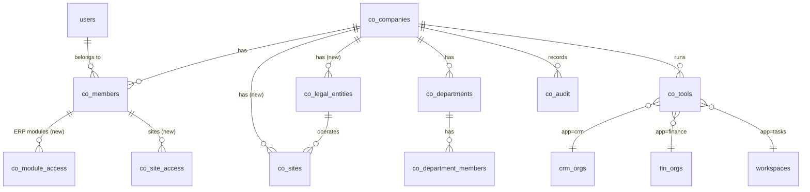
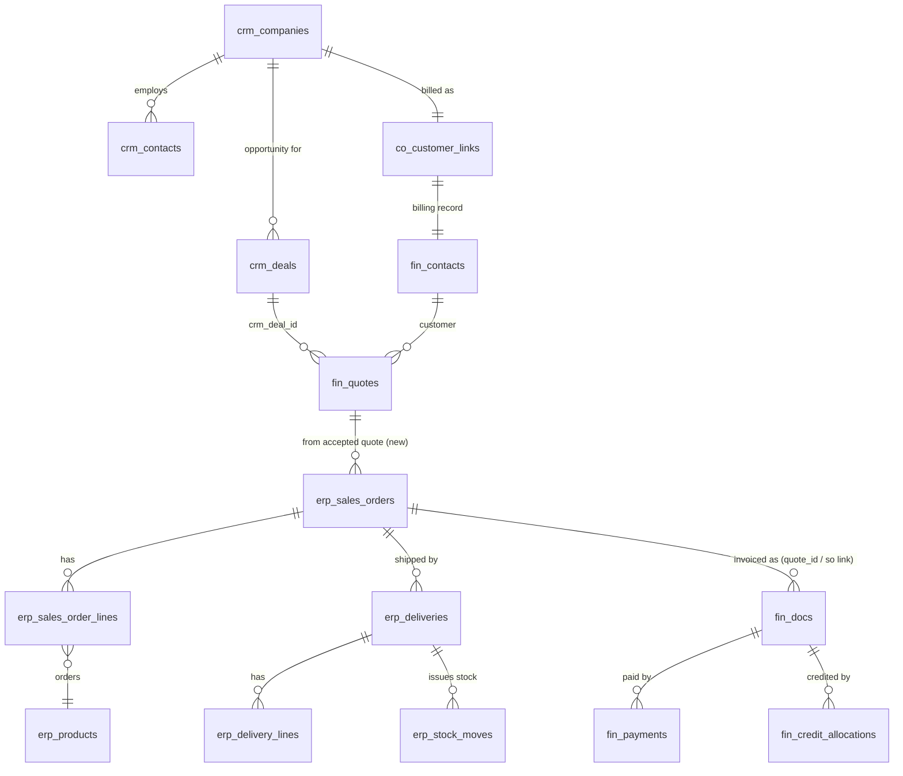
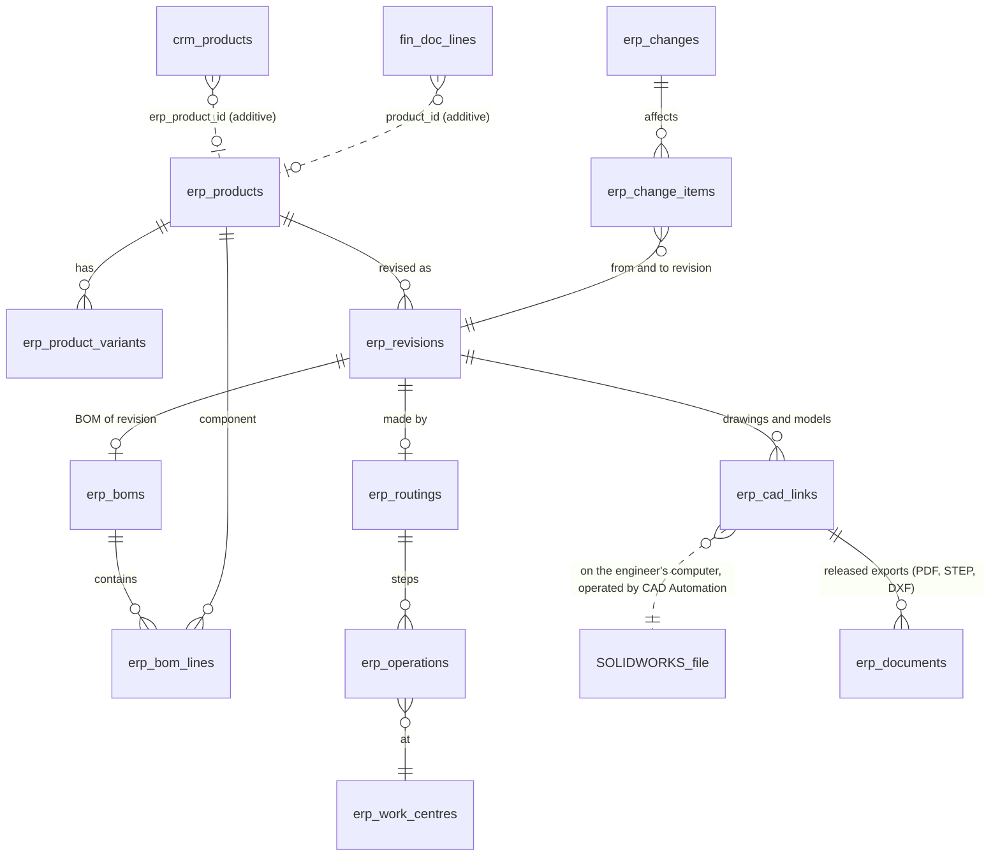
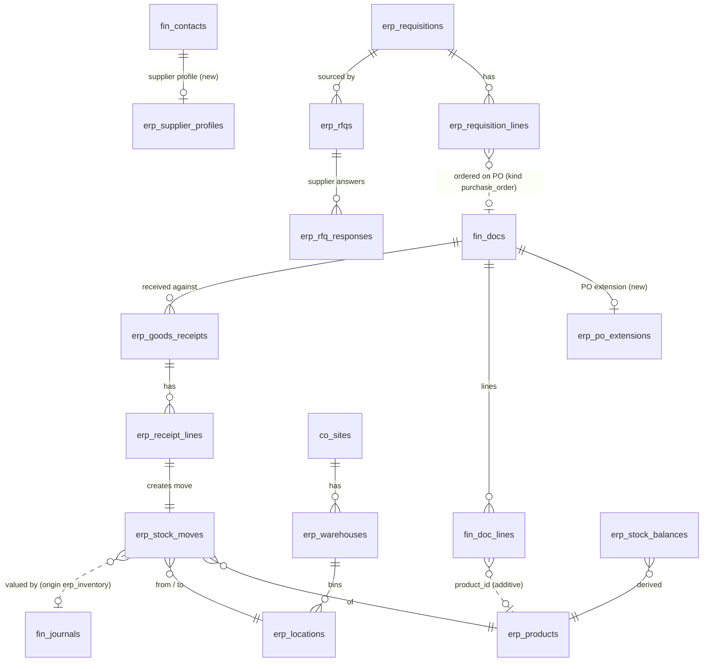
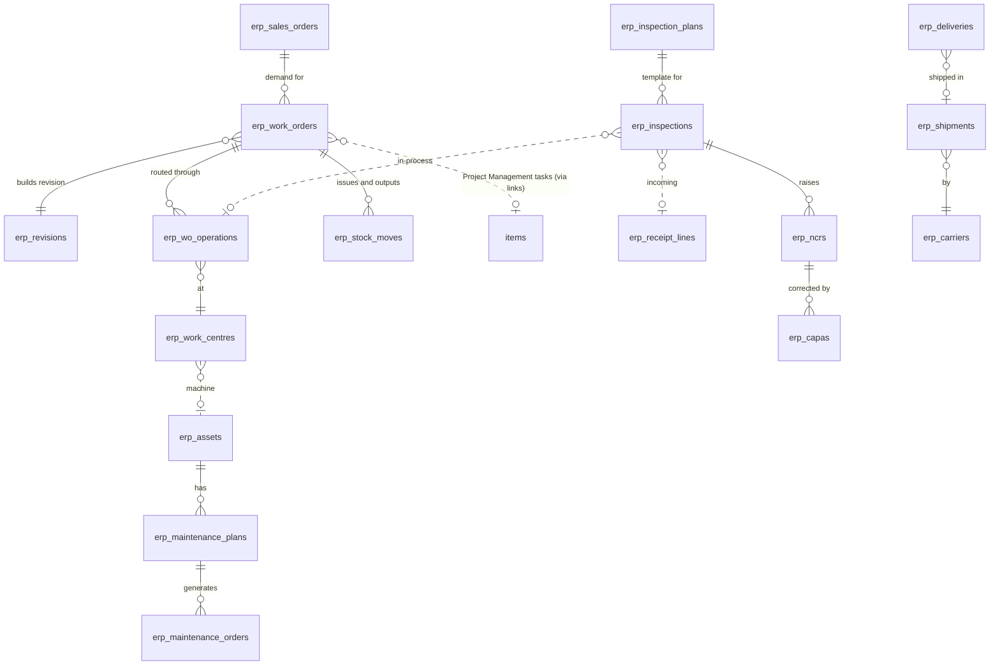
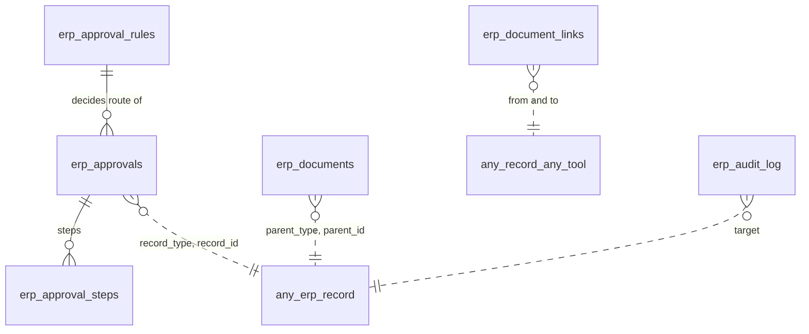

# 5. Database entity relationship design

Status: proposal for review. Existing tables are shown with their real names; new tables are marked **new**. Every
new table lives in the same database as today (SQLite on the `work_data` volume, D1 in tests), uses the `erp_`
prefix (or `co_` for Core), and follows the rules the database already enforces for Finance:

- every row carries its tenant (`company_id`), and every reference inside ERP is a composite foreign key
  `(company_id, <ref>_id)`, so a record can never point into another company (as Finance does with `org_id`);
- references to another tool's records are plain columns checked by the server against `co_tools` (a company's CRM
  organisation, Finance workspace and Project Management workspace), because each tool has its own tenant key;
- identifiers are the app's random ids (`newId()`); people-facing numbers come from a per-company counter
  (`erp_counters`), with prefixes (SO-, PO is Finance's, GR-, WO-, NCR-, ...);
- money is integer cents in the company's currency (Finance's rule); quantities are integer thousandths
  (`quantity_milli`, Finance's rule), so stock arithmetic is exact;
- soft delete (`deleted_at`) for documents and masters; posted stock moves are never edited (a reversal move corrects
  them, as journals do), enforced by triggers like `fin_journal_posted_frozen`.

## 5.1 Core: organisation, people, access

New Core tables:

| Table | Key columns | Notes |
| --- | --- | --- |
| `co_legal_entities` | id, company_id, name, legal_name, abn, acn, gst_registered, fin_org_id (the entity's Finance business workspace), is_primary | A company starts with one entity mirroring `co_companies`; more entities each get their own Finance workspace (books are per legal entity) |
| `co_sites` | id, company_id, legal_entity_id, code, name, kind (office, plant, warehouse, store), address fields, timezone, archived_at | Branch and site selector; warehouses belong to a site |
| `co_module_access` | company_id, user_id, module, level (`none`, `view`, `contribute`, `approve`, `manage`) | One row per ERP module per person; set from role templates (section 7) |
| `co_site_access` | company_id, user_id, site_id | Empty means all sites; limits record visibility for site-scoped modules |
| `co_role_templates` | company_id, key, name, modules_json, tool_roles_json | The twelve personas as editable templates |

`co_tools.app` keeps its CHECK (`tasks`, `crm`, `finance`). ERP is not a separate tool tenant: its records belong to
the company directly, so no change to `co_tools` is needed.

## 5.2 Sales: customer to cash

| New table | Key columns |
| --- | --- |
| `erp_sales_orders` | id, company_id, number, site_id, crm_company_id, fin_contact_id, crm_deal_id, quote_id (`fin_quotes.id`), status (`draft`, `confirmed`, `in_production`, `partly_delivered`, `delivered`, `invoiced`, `closed`, `cancelled`), order_date, promised_date, delivery_address, currency, totals (from the quote or priced by Finance's `priceDocLines`), created_by |
| `erp_sales_order_lines` | id, company_id, sales_order_id, line_no, product_id, variant_id, description, quantity_milli, unit, unit_price, discount_bp, tax_code_id (Finance's), delivered_milli, invoiced_milli |
| `erp_deliveries` | id, company_id, number, sales_order_id, site_id, warehouse_id, status (`picking`, `packed`, `shipped`, `delivered`, `returned`), shipment_id, delivered_at, received_by |
| `erp_delivery_lines` | id, company_id, delivery_id, so_line_id, product_id, quantity_milli, lot_id, serial |

Invoices made from a sales order are Finance invoices (`fin_docs` kind `invoice`) created through `createDoc`; the
link is `erp_document_links` (section 5.7) with relation `invoices`.

## 5.3 Products and engineering

| New table | Key columns |
| --- | --- |
| `erp_products` | id, company_id, code (unique per company), name, kind (`stocked`, `manufactured`, `purchased`, `service`, `kit`), unit, category_id, status (`draft`, `active`, `obsolete`), current_revision_id, sales_account_id and purchase_account_id (Finance accounts), tax_code ids, standard_cost, list_price, weight, dimensions, tracking (`none`, `lot`, `serial`), created_by |
| `erp_product_variants` | id, company_id, product_id, code, attributes_json (size, finish), price_delta |
| `erp_revisions` | id, company_id, product_id, revision (A, B, C...), status (`in_work`, `in_review`, `released`, `superseded`), released_at, released_by, change_id |
| `erp_boms` / `erp_bom_lines` | bom: id, company_id, revision_id, kind (`engineering`, `manufacturing`), quantity_milli; line: component_product_id, quantity_milli, unit, scrap_bp, reference_designator, operation_id |
| `erp_routings` / `erp_operations` / `erp_work_centres` | routing per revision; operation: sequence, work_centre_id, setup_minutes, run_minutes_per_unit; work centre: site_id, capacity_minutes_per_day, cost_rate |
| `erp_changes` / `erp_change_items` | change: number (ECR-/ECO-), kind (`request`, `order`), reason, status (`draft`, `submitted`, `approved`, `implemented`, `rejected`), approval_id; item: from_revision_id, to_revision_id, disposition of stock (`use_up`, `rework`, `scrap`) |
| `erp_cad_links` | id, company_id, revision_id, cad_kind (`part`, `assembly`, `drawing`), file_name and path as reported by the add-in, cad_revision (the file's own revision property), last_command_id (CAD Automation's command, for status), exported_document_id (`erp_documents`: the released PDF, STEP or DXF, because CAD Automation's export links last one hour), linked_by. CAD Automation keeps no models on its server: the SOLIDWORKS file on the engineer's computer stays the master copy |

## 5.4 Procurement and inventory

| New table | Key columns |
| --- | --- |
| `erp_supplier_profiles` | fin_contact_id (PK), company_id, lead_time_days, min_order_value, payment_terms, approved_status (`prospect`, `approved`, `on_hold`, `blocked`), rating, certifications_json |
| `erp_requisitions` / lines | number (REQ-), requested_by, department_id, site_id, needed_by, status, approval_id; line: product_id, quantity_milli, estimated_price, suggested_supplier_id |
| `erp_rfqs` / `erp_rfq_responses` | rfq per requisition; responses per supplier with price, lead time, valid_until |
| `erp_po_extensions` | fin_doc_id (PK, the Finance purchase order), company_id, site_id, warehouse_id, requisition_id, expected_date, receiving_status (`not_received`, `partly_received`, `received`, `closed`) |
| `erp_goods_receipts` / `erp_receipt_lines` | number (GR-), fin_doc_id (PO), warehouse_id, received_at, received_by, status; line: fin_doc_line_no, product_id, quantity_milli, accepted_milli, rejected_milli, lot, location_id, inspection_id |
| `erp_warehouses` / `erp_locations` | warehouse: site_id, code, name; location: warehouse_id, code (aisle-rack-bin), kind (`receiving`, `storage`, `staging`, `quarantine`) |
| `erp_stock_moves` | id, company_id, date, product_id, variant_id, quantity_milli (positive), from_location_id, to_location_id (one may be null for receipts and issues), unit_cost, lot_id, serial, source_type (`receipt`, `delivery`, `transfer`, `issue_to_wo`, `wo_output`, `count_adjust`, `scrap`, `reversal`), source_id, status (`draft`, `posted`), journal_id (Finance), reverses_id |
| `erp_stock_balances` | company_id, product_id, location_id, lot_id, on_hand_milli, reserved_milli, value_cents: a derived table rebuilt from moves, never edited by hand |
| `erp_lots` | id, company_id, product_id, code, expiry_date, supplier_lot |

## 5.5 Manufacturing, quality, assets, logistics

| New table | Key columns |
| --- | --- |
| `erp_work_orders` | number (WO-), product_id, revision_id, quantity_milli, site_id, sales_order_id, status (`planned`, `released`, `in_progress`, `completed`, `closed`, `cancelled`), planned_start, planned_end, actual_start, actual_end, priority |
| `erp_wo_operations` | work_order_id, sequence, work_centre_id, status, planned_minutes, actual_minutes, quantity_done_milli, scrap_milli, operator_id |
| `erp_inspection_plans` / `erp_inspections` | plan: product_id, stage (`incoming`, `in_process`, `final`), characteristics_json (name, method, nominal, tolerance); inspection: number (INS-), plan_id, source (receipt line, operation, delivery), sample_size, results_json, result (`pass`, `fail`, `conditional`), inspector_id |
| `erp_ncrs` / `erp_capas` | NCR: number, source inspection, product, quantity, disposition (`use_as_is`, `rework`, `scrap`, `return_to_supplier`), approval_id; CAPA: root cause, actions (linked Project Management tasks), due dates, effectiveness check |
| `erp_assets` | number (AST-), name, site_id, location, kind, manufacturer, model, serial, commissioned_on, status, work_centre_id, fin_fixed_asset_id (when Finance Stage 3 exists) |
| `erp_maintenance_plans` / `erp_maintenance_orders` | plan: asset_id, trigger (`calendar`, `meter`), interval, checklist_json; order: number (MO-), kind (`preventive`, `corrective`), status, downtime_minutes, parts used (stock moves), labour |
| `erp_shipments` / `erp_carriers` | shipment: number (SHP-), carrier_id, tracking_ref, ship_date, eta, status, freight_cost; carrier: name, service levels, Finance supplier contact id |

## 5.6 Approvals, documents, audit, numbering

| New table | Key columns |
| --- | --- |
| `erp_approval_rules` | company_id, record_type, condition_json (amount over, site, department), steps_json (role or person per step, any or all) |
| `erp_approvals` / `erp_approval_steps` | approval: record_type, record_id, status (`pending`, `approved`, `returned`, `cancelled`), requested_by; step: sequence, approver (user or role), decision, comment, decided_at |
| `erp_documents` | id, company_id, parent_type, parent_id, name, mime, size, storage_key (the same file store as Finance and Project Management), version, uploaded_by, deleted_at |
| `erp_document_links` | company_id, from_ref, to_ref, relation: typed references across tools, e.g. `erp:so:<id>` invoices `fin:doc:<id>`, `erp:wo:<id>` tracked by `tasks:item:<id>`, `erp:rev:<id>` drawn in `cad:command:<id>` |
| `erp_audit_log` | same columns as `fin_audit_log` (actor, action, target, before, after, metadata, ip, created_at) |
| `erp_counters` | company_id, key, last_number (as `fin_counters`) |
| `erp_events` | id, company_id, type, payload_json, created_at, processed_at, attempts: the outbox for asynchronous reactions (section 6) |

## 5.7 Additive changes to existing tables (no rebuilds)

| Table | Change | Why |
| --- | --- | --- |
| `crm_products` | `ADD COLUMN erp_product_id TEXT` | Link the CRM deal catalogue to the product master |
| `fin_doc_lines` | `ADD COLUMN product_id TEXT` | Product on invoice, bill and purchase order lines; carried by `docInput` when lines are rewritten |
| `fin_quote_lines`, `fin_credit_note_lines` | `ADD COLUMN product_id TEXT` | Same |
| `fin_journals` | `ADD COLUMN origin TEXT` | Names journals another module posts (`erp_inventory`, `erp_wip`, `credit_note`), so they can be shown and protected without widening the `source_type` CHECK, which cannot change without rebuilding the ledger table; the manual-reversal route refuses journals with an origin |
| `co_departments` | none | Already carries the team ids of each tool |

All are `ALTER TABLE ... ADD COLUMN` with a NULL or constant default, the pattern of migrations 0013 to 0015. No
existing table is rebuilt, no CHECK constraint is widened, and no row is rewritten.
