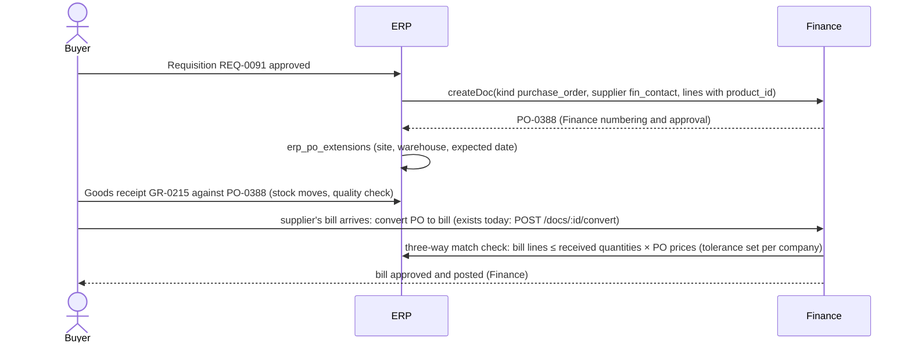

# 6. Cross-module API and integration specification

Status: proposal for review. Nothing in this document is built yet, except where marked "exists today".

## 6.1 How modules talk

CRM, Finance, Project Management, Company and the proposed ERP all run in **one application** (`apps/work`: one Hono
app, one database, one deployment). That decides the integration style:

| Style | Used for | Why |
| --- | --- | --- |
| **In-process service call** (a TypeScript function of the owning module, e.g. Finance's `createDoc`, the CRM's `customerFor`) | Every write into another module's records | The owner's validation, numbering, permission checks and audit run unchanged. No network hop, no second copy of logic. This is how `src/worker/company/links.ts` works today. |
| **One database transaction** (`db.batch`) | Writes that must succeed or fail together inside one module | SQLite (and D1) batches are atomic. Cross-module writes are not forced into one batch: each module keeps its own boundary (section 6.4). |
| **Outbox event** (`erp_events`, processed after the request and by the 15-minute maintenance run) | Reactions that may happen later: CRM timeline entries, notifications, My Work counts, derived balances | A slow or failing reaction never blocks or undoes the business action. |
| **HTTP API** (REST over the existing `/api` prefix of each mount) | The ERP screens, mobile use, and future external clients | Same session cookie and CSRF rules as today; API tokens (`wos_`) for scripts. |
| **MCP over HTTPS with the person's OAuth token** | CAD Automation (a separate app, `cados`, in another region) | Its only machine interface is MCP, acting as one person; it is called for the engineer once its "Sign in with BIZOMAT" is built (`docs/company/README.md`). |

### Module service boundary (the rule)

Each module exposes a small service module that other modules import; nothing outside a module writes its tables.

```
apps/work/src/worker/
  crm/       services: customerFor, dealSummary, addTimelineEvent (eventStmt)
  fin/       services: createDoc, approveDoc, createQuote, invoiceQuote, postJournal (new wrapper over journalStmts), contactFor
  services/  Project Management: createItem, assignItem, completeItem (item-ops.ts)
  company/   services: companyOf, companyTools, membership, moduleAccess (new)
  erp/       (new) products, sales, procurement, inventory, manufacturing, quality, maintenance, logistics, reports
```

## 6.2 Identifiers

- Every record keeps its own table's id. Cross-tool references use a **typed reference** string so they are never
  ambiguous: `<app>:<kind>:<id>`, for example `crm:company:9f2c…`, `fin:doc:71ab…`, `fin:quote:…`, `tasks:item:…`,
  `erp:so:…`, `erp:wo:…`, `cad:command:…`.
- People-facing numbers stay per owner: Finance numbers invoices (`INV-0042`), quotes (`QU-0107`) and purchase orders
  (`PO-0388`); ERP numbers its own records (`SO-1048`, `GR-0215`, `WO-1042`, `INS-0533`, `NCR-0031`, `AST-0007`).
- External identifiers (a supplier's part number, a CAD file id) are stored as attributes, never as primary keys.

## 6.3 API conventions (ERP)

- Base: `https://bizomat.ai/erp/api/erp/c/:company/...` (the ERP mount uses the same `/api` routes as every mount;
  the company is in the path as `/company/api/company/c/:company` is today).
- JSON in and out; money in cents with the company currency; quantities as decimals in JSON, stored as thousandths.
- Lists: `?q=`, `?status=`, `?site=`, `?from=&to=`, `?sort=field:asc`, `?cursor=`; `format=csv` exports (needs the
  module's export right, audited).
- Writes: `POST` create, `PATCH` change, `POST /:id/<action>` for state changes (`/confirm`, `/release`, `/receive`,
  `/approve`). Each state change returns the record.
- Idempotency: `Idempotency-Key` header on create and action calls from the ERP screens and mobile scanners; the key
  and the response are kept 24 hours (`erp_idempotency`), so a double tap never makes two receipts.
- Errors: the app's existing shape `{ "error": "Plain sentence", "details": {...} }` with 400, 403, 404 (also for
  records of another company), 409 (state conflict), 429.
- Concurrency: optimistic, with `updated_at` sent back on `PATCH` (`If-Unmodified-Since` style field `version`); a
  stale write gets 409.

## 6.4 Transaction boundaries

| Flow step | Boundary | Failure handling |
| --- | --- | --- |
| Within one module (a goods receipt and its stock moves) | One `db.batch`, atomic | All or nothing |
| ERP calls an owner service (create a Finance invoice) | The owner's own batch | ERP first **claims** its side (e.g. marks the sales-order lines as being invoiced, guarded by a status condition), then calls the owner, then **confirms**; if the owner refuses, ERP **releases** the claim. This is the pattern `invoiceQuote` uses today (claim the share, create the invoice, give it back on failure). |
| Reactions (CRM timeline, notifications, balances) | Outbox event after the commit | Retried with backoff; never undo the business action |

## 6.5 Flows

### A. CRM customer → ERP sales order → Finance invoice

```mermaid
sequenceDiagram
  actor S as Sales manager
  participant CRM
  participant FIN as Finance
  participant ERP
  S->>CRM: Deal "Switchboard upgrade" (crm_deals)
  S->>FIN: Quote from the deal (exists today: links.ts POST /crm/:org/deals/:id/quote)
  FIN-->>S: QU-0107 sent, customer accepts online (exists today)
  S->>ERP: POST /erp/api/erp/c/:co/sales-orders {quoteRef: "fin:quote:…"}
  ERP->>FIN: read quote, lines, customer (fin_contacts via co_customer_links)
  ERP-->>S: SO-1048 confirmed (lines with product ids, promised date)
  ERP->>ERP: delivery DL-0311 shipped (stock moves)
  S->>ERP: POST /sales-orders/:id/invoice {deliveryId}
  ERP->>ERP: claim delivered, not yet invoiced quantities
  ERP->>FIN: createDoc(kind invoice, contactId, lines with product_id, quoteId)
  FIN-->>ERP: INV-2291 (draft, Finance approval posts it)
  ERP->>ERP: confirm invoiced quantities; erp_document_links so→invoice
  ERP-)CRM: event so.delivered → crm_events on the deal and company (no amounts)
```

Request example:

```http
POST /erp/api/erp/c/co_7Hk2/sales-orders HTTP/1.1
Content-Type: application/json
Idempotency-Key: 4c1d1b3e-2a6e-4a0b-9d0e-6a1f2f5b7c10

{ "quoteRef": "fin:quote:q_9Kx1", "siteId": "site_bne", "promisedDate": "2026-12-04" }
```

```json
{ "id": "so_Q81m", "number": "SO-1048", "status": "confirmed", "customer": { "crmCompanyId": "cc_31", "finContactId": "fc_88", "name": "Harbour Builders" },
  "lines": [{ "lineNo": 1, "productId": "prd_1001", "quantity": 4, "unitPrice": 125000, "taxCodeId": "tx_gst" }],
  "links": [{ "relation": "from_quote", "ref": "fin:quote:q_9Kx1", "number": "QU-0107" }] }
```

Rules: one sales order per accepted quote unless split on purpose; quantities invoiced never exceed quantities
delivered (or ordered, for services); voiding the Finance invoice releases the invoiced quantities (as quote shares
are released today).

### B. ERP product → CAD drawing generation → ERP product revision

What CAD Automation offers today (`docs/erp/discovery/cad-automation.md`): a separate app (`cados`) whose only
machine-to-machine interface is its MCP endpoint, acting as one signed-in person over OAuth 2.1; every operation runs
on that person's own Windows computer through the SOLIDWORKS add-in and the Companion; the server keeps no models;
exports are download links that last one hour; there are no organisations, service accounts, webhooks or BOM and
revision data. So ERP integrates as a client acting **for the engineer**, never as a background service.

```mermaid
sequenceDiagram
  actor E as Engineer (signed in to ERP and to CAD Automation with the same BIZOMAT account, once CAD accepts it)
  participant ERP
  participant CAD as CAD Automation (cados, MCP endpoint)
  participant PC as Engineer's SOLIDWORKS computer (add-in and Companion)
  E->>ERP: Product PRD-1001, revision C in work: "Create drawing"
  ERP->>CAD: MCP tools/call sw_create_drawing {model path, template, title block: code, name, revision C} (the engineer's OAuth token)
  CAD->>PC: command to the paired computer (long poll)
  PC-->>CAD: drawing created on the engineer's computer
  CAD-->>ERP: command id; ERP polls sw_command_status
  ERP->>CAD: sw_export {format: PDF and DXF}
  CAD-->>ERP: download links (valid one hour)
  ERP->>ERP: fetch the files at once into erp_documents; erp_cad_links on revision C (file name, CAD revision, command id)
  E->>ERP: submit engineering change ECO-0019
  ERP->>ERP: approved → revision C released (exports frozen), B superseded
```

Rules:
- Needs, in order: CAD Automation accepting BIZOMAT accounts (its side of "Sign in with BIZOMAT" is not built), ERP
  holding a per-person CAD token (OAuth with PKCE, refresh), and the engineer's computer switched on and paired.
- Until then, ERP offers only "Link a drawing" (upload the PDF or DXF and record the file name and revision by hand);
  the "Create drawing" action is not shown.
- The released revision's exports live in ERP (`erp_documents`), because CAD Automation's links expire and its
  server keeps no files.
- A CAD service account, a job API with callbacks and BOM extraction would make this smoother; they are changes to
  `kevinjogin/bizomat-cad`, listed in `12-deployment-and-infrastructure.md` as recommendations.

### C. ERP production order → Project Management tasks

```mermaid
sequenceDiagram
  actor P as Production manager
  participant ERP
  participant PM as Project Management
  P->>ERP: Release WO-1042
  ERP->>ERP: status released; reserve components (stock reservations)
  ERP->>PM: createItem on the company's board "Production" (one task per operation, assignee, due dates)
  PM-->>ERP: item ids → erp_document_links (wo operation ↔ tasks:item)
  Note over PM,ERP: completing the task in Project Management emits item.completed
  PM-)ERP: event → operation marked done (if the operator has the right), WO progress updated
```

Rules: the work order owns quantities, materials and status; the tasks own collaboration (comments, files,
assignment). Closing the work order closes open linked tasks; deleting a task never deletes the operation.

### D. ERP purchase order → Finance supplier bill



### E. ERP stock movement → Finance inventory valuation

- Each posted stock move with a value change (receipt, issue to work order, output, delivery, count adjustment,
  scrap) adds an outbox event `stock.valued`.
- A Finance service `postJournal({ origin: 'erp_inventory', sourceId: moveId, date, lines })` posts the journal through
  `journalStmts` (balanced, lock date and immutability triggers apply). Examples, perpetual inventory at standard or
  average cost:

| Move | Debit | Credit |
| --- | --- | --- |
| Receipt against PO | Inventory | Goods received not invoiced (GRNI) |
| Supplier bill matched | GRNI | Accounts payable (already posted by the bill; the bill's line account is GRNI) |
| Issue to work order | Work in progress | Inventory |
| Work order output | Finished goods inventory | Work in progress |
| Delivery to customer | Cost of goods sold | Finished goods inventory |
| Count adjustment or scrap | Inventory adjustments (expense) | Inventory (or the reverse) |

- Journals are summarised per day and product category when volume is high (one journal per day per site), keeping
  the ledger readable; the move-level detail stays in ERP.
- Requires the additive `fin_journals.origin` column and three system accounts in the chart (Inventory, GRNI, WIP),
  added to business charts on first ERP use.

### F. ERP completed delivery → CRM customer history

- Event `delivery.completed` → `crm_events` row on the CRM company (and the deal, when the sales order came from one):
  "Delivery DL-0311 for SO-1048 completed", type `erp_delivery`, no amounts (CRM users may not see financial
  figures). The CRM timeline already renders unknown event types with a fallback icon.

### G. ERP project cost → Finance reporting

- Exists today: a Project Management project gets a Finance tracking project (`co_project_links`), and postings to it
  show as costs and income against a budget (`links.ts`).
- ERP adds: work-order labour and materials (from stock moves and operation hours × work-centre rates) post to the WIP
  journal lines with the tracking project of the linked project, so Finance's reports by project include production
  cost. Finance stays the only source of posted figures.

## 6.6 Events (outbox)

| Event | Emitted by | Reactions |
| --- | --- | --- |
| `so.confirmed`, `so.delivered`, `so.invoiced` | ERP sales | CRM timeline, My Work, notifications |
| `quote.accepted` (exists as a quote event today) | Finance | ERP suggests a sales order; CRM timeline (exists) |
| `po.approved`, `po.received` | Finance, ERP | ERP expected receipts; Finance three-way match status |
| `stock.valued` | ERP inventory | Finance journal |
| `wo.released`, `wo.completed` | ERP manufacturing | Project Management tasks; stock output; CRM history when made to order |
| `item.completed` | Project Management | ERP operation progress |
| `inspection.failed` | ERP quality | NCR draft; notification to the quality manager |
| `approval.requested`, `approval.decided` | ERP, Finance | My Work |

Each event row: `id`, `company_id`, `type`, `payload_json` (identifiers only, never personal data or amounts beyond
what the receiving module may see), `created_at`, `processed_at`, `attempts`, `last_error`. Handlers are idempotent
(keyed by event id).

## 6.7 Permissions on every call

1. The caller must be a member of the company (`co_members`).
2. The caller needs the module level for the action (`co_module_access`: view, contribute, approve, manage).
3. Site scope: records of a site-scoped module are visible only for the caller's sites (`co_site_access`).
4. The owning module checks its own rights again when ERP calls it (a Finance role that cannot create invoices cannot
   invoice a sales order from ERP, exactly as `links.ts` checks today).
5. Every cross-module reference is checked to be in the same company (`co_tools`) before it is stored.

## 6.8 Preventing duplicates and conflicts

- Customers: only through `customerFor` (CRM company → linked Finance contact, made once).
- Suppliers: one Finance contact per supplier; ERP profile keyed by its id (primary key prevents a second profile).
- Products: unique `(company_id, code)`; the CRM catalogue links, never copies.
- Documents created from another record keep a unique link (`erp_document_links` unique on `from_ref, relation,
  to_ref`), and "create" actions check for an existing link first (as "Won deal to invoice" refuses a second invoice).
- Quantities: claimed with guarded updates (`WHERE invoiced_milli + ? <= delivered_milli`) so two people cannot
  invoice or receive the same quantity twice.
