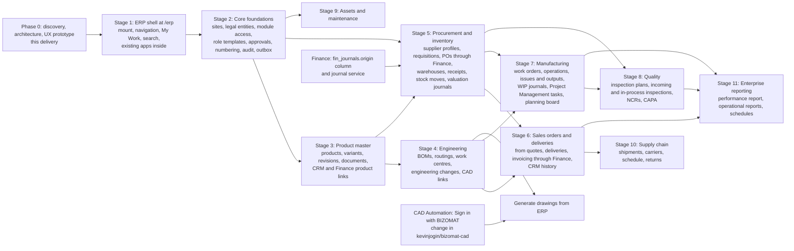

# 10. Development roadmap and dependencies

Status: proposal for review. Each stage ends with tests, a review by the owner and, only when approved, a release
through the existing deploy workflow. No stage needs a new Fly app, Machine, server or database.

## 10.1 Dependency graph

## 10.2 Stages

| Stage | Scope | Depends on | Ends with | Not included |
| --- | --- | --- | --- | --- |
| 0 | Discovery, architecture (this folder), UX specification and clickable prototype | none | Owner review and approval | Any production code |
| 1 | `/erp` mount (one more entry in `MOUNTS`, proxy `ERP_PATHS`, website Worker route), ERP route table in the SPA, shell (header, sidebar, breadcrumbs, company selector), role dashboards with widgets fed by existing APIs only, My Work across Project Management, CRM and Finance, global search across them, existing apps opened in the shell, ERP in the website navigation (beside the existing items) | 0 | Release after review; every existing address unchanged | New ERP records |
| 2 | Core: `co_sites`, `co_legal_entities`, `co_module_access`, `co_site_access`, `co_role_templates`, approval engine, ERP numbering, `erp_audit_log`, `erp_events` outbox and processor, Administration screens | 1 | Release | Module data |
| 3 | Product master: products, variants, categories, units, revisions, documents; links from CRM products and Finance lines (additive columns) | 2 | Release; first new ERP data | BOMs |
| 4 | Engineering: BOMs, compare, where-used, routings, work centres, engineering changes with approvals, CAD links by hand | 3 | Release | Generated drawings |
| 5 | Procurement and inventory: supplier profiles, requisitions, RFQs, POs through Finance with product lines, warehouses and locations, goods receipts, stock moves, on hand, transfers, counts, valuation journals (needs `fin_journals.origin` and Inventory, GRNI and WIP accounts) | 2, 3 | Release | Lots and serials (P2 inside the stage if time) |
| 6 | Sales orders and deliveries: from quotes and deals, reservations, picking, deliveries, invoicing through Finance, CRM history | 3, 5 | Release | Shipments |
| 7 | Manufacturing: work orders, release with availability, operations reporting, issues and outputs, WIP journals, tasks in Project Management, planning board, shop floor | 4, 5 | Release | MRP |
| 8 | Quality: inspection plans, incoming inspection with quarantine, in-process and final, NCRs with disposition, CAPA with tasks | 5, 7 | Release | Certificates |
| 9 | Assets and maintenance: register, plans, orders, requests, downtime | 2 (and 5 for parts) | Release | Finance depreciation link (Finance Stage 3) |
| 10 | Supply chain: carriers, shipments, delivery schedule, returns | 6 | Release | Carrier integrations |
| 11 | Enterprise reporting: company performance, operational reports, saved and scheduled reports | 6, 7, 8 | Release | - |
| Parallel | CAD Automation accepts BIZOMAT accounts (in `kevinjogin/bizomat-cad`), then "Generate drawing" in ERP | Access to that repository; the `BIZOMAT_ID_CLIENTS` and CAD client secrets set by the owner | Release of both apps | - |
| Parallel | Finance Stages 2 to 4 of its own brief (BAS module, banking, payroll) | Finance roadmap | Their own releases | - |

## 10.3 Order of value for a small manufacturer

1. Stage 1 gives one place to work and My Work, with no data migration.
2. Stage 3 to 5 replace spreadsheets for products, BOMs, purchasing and stock, the usual first pain.
3. Stage 6 and 7 connect sales to production and delivery.
4. Stage 8 to 11 add control and insight as the company grows.

## 10.4 What can change the order

- If CAD Automation's sign-in lands early, the drawing generation moves into Stage 4.
- A business that only trades (no production) can skip Stage 4 and 7 and still use 5 and 6.
- Measured capacity on the work Machine (section 12) may require the owner to approve more memory before Stage 5
  (stock moves) goes live; the preflight refuses any resize without that approval.
