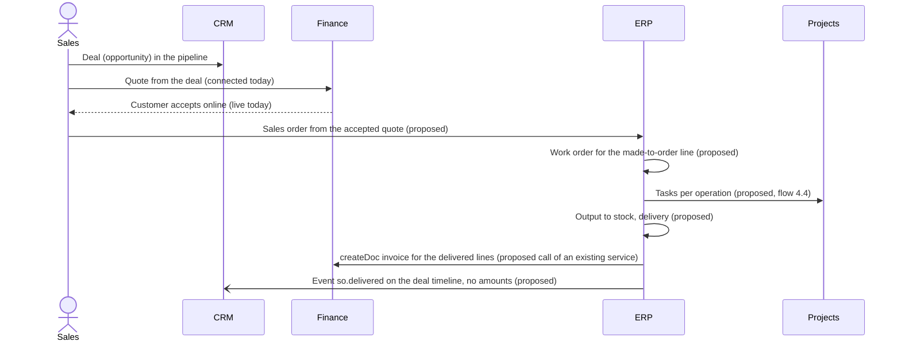

# 14. Application integration map

Status: read from the code on 14 Nov 2026. How the CRM, Finance, Projects, Company accounts, CAD Automation and BIZOMAT
ERP connect today, and how the planned modules will connect. Every link marked live or connected exists in the code
named; every endpoint marked **proposed** is a design, not built. The capability statuses are in
`13-enterprise-capability-matrix.md`; the earlier design of the flows is in `06-integration-specification.md`, which this
page brings up to date.

## 1. Rules every connection keeps

1. **One system of record per entity.** The owner creates, changes, numbers and deletes it. Everyone else keeps an
   identifier and reads it through the owner (`04-master-data-ownership.md`).
2. **No copies.** The ERP never copies customer or financial records into ERP tables. Names, addresses, amounts and
   balances are read from the CRM and Finance when needed. A sent document keeps the version it was sent with, inside
   Finance, because the law and the customer need it.
3. **Writes go through the owner's service**, in process: Finance's `createDoc` (`fin/docs.ts`), `createQuote` and
   `dealEventStmt` (`fin/sales.ts`), `journalStmts` (`fin/ledger.ts`); Projects' `createItem`
   (`services/item-ops.ts`); the company links' `customerFor` (`company/links.ts`). The owner's permission checks,
   numbering, validation and audit run unchanged.
4. **Same company, both permissions.** A link is stored only when both records belong to tools of the same company
   (`co_tools`), and only for a person whose role in each tool allows the action. Anything else answers 404 or 403.
5. **One application.** The CRM, Finance, Projects, Company accounts and the ERP are one Hono app (`apps/work`), one
   database and one sign-in. Every mount serves the same `/api`, so `https://bizomat.ai/erp/api/...` and
   `https://bizomat.ai/company/api/...` reach the same routes. CAD Automation is a separate app (`cados`) reached over
   HTTPS. No new Fly app, Machine, database or login system is added for any connection below.

## 2. Systems, what they own and their ids

| System | Where | Tenant id | Owns (system of record) | Never owns |
| --- | --- | --- | --- | --- |
| Company accounts | `/company`, inside the ERP at `/erp/company` | `co_companies.id` | Companies, members and their tool roles, departments, invitations, the links between tools (`co_tools`, `co_customer_links`, `co_deal_links`, `co_project_links`), the BIZOMAT sign-in provider | Customers, money, tasks |
| BIZOMAT ERP | `/erp` | `co_companies.id`, or `sys_companies.id` for a person's own company | Own companies, the CAD status reports (`sys_cad_status`); in development: maintenance (`mt_*`); planned: products, orders, stock, work orders and the other `erp_*` records | Anything a tool owns |
| CRM | `/crm`, `/erp/crm` | `crm_orgs.id` | Customers (companies), contacts, leads, deals, activities, CRM products until the product master exists | Invoices, amounts owed |
| Finance | `/finance`, `/erp/finance` | `fin_orgs.id` (a business workspace for a company) | Ledger, accounts, tax codes, tracking, contacts as billed customers and suppliers, quotes, invoices, credit notes, bills, purchase orders, payments recorded | Stock quantities, production, CRM history |
| Projects | `/tasks`, `/erp/tasks` | `workspaces.id` | Projects (boards), tasks (items), schedules, time and cost entries, documents | Posted costs (Finance owns them) |
| CAD Automation | `/cad`, app `cados` | its own accounts; the BIZOMAT account id (`sub`) once Sign in with BIZOMAT is merged | Its accounts, paired computers, AI app grants, command history. The SOLIDWORKS files stay on the engineer's computer | Product records, BOMs, revisions |

### 2.1 Identifiers carried between systems

| Identifier | Where it comes from | Carried by |
| --- | --- | --- |
| Company id | `co_companies.id` | Every link; the ERP's company switcher; proposed ERP API paths `/api/erp/c/:company/...` |
| Tool tenant ids | `co_tools` (the company's workspace, CRM organisation and Finance business workspace) | Every link checks both ids belong to the same company |
| Record ids | Each owner's table | Stored in link tables; proposed typed references `<app>:<kind>:<id>`, such as `crm:deal:...`, `fin:quote:...`, `fin:doc:...`, `tasks:item:...`, `erp:so:...`, `erp:wo:...`, `mt:asset:...`, `mt:wo:...`, `cad:command:...` |
| Person | `users.id` | Every request (session cookie or personal API token) |
| BIZOMAT account to CAD Automation | `sub` from `/company/api/id/userinfo`, or an email confirmed on both sides | CAD status reports; Sign in with BIZOMAT (in development) |
| People-facing numbers | Each owner's numbering (`QU-0107`, `INV-0042`, `PO-0388`) | Shown beside links; never used as keys |

## 3. Connections today

### 3.1 Connected (works today)

All link routes are under `/api/company/links` (`apps/work/src/worker/company/links.ts`) unless named otherwise.

| # | Connection | From → to | API or service | Stored | Tests |
| --- | --- | --- | --- | --- | --- |
| 1 | One customer record | CRM company → Finance contact | `GET /crm/:org/companies/:id`, `POST /crm/:org/companies/:id/customer`; from Finance: `GET /finance/:org/crm-customers`, `POST /finance/:org/crm-customers/:id` | `co_customer_links` (two ids). Open invoices and the amount owed are read from Finance on request, shown only to roles that see sales | `company-links.test.ts` |
| 2 | Quote from a CRM deal | CRM deal → Finance quote | `POST /crm/:org/deals/:id/quote`; Finance's `createQuote`; each quote step goes to the deal timeline through `dealEventStmt` (no amounts) | `fin_quotes.crm_deal_id`, `crm_events` | `fin-sales.test.ts` |
| 3 | Won deal to draft invoice | CRM deal → Finance invoice | `POST /crm/:org/deals/:id/invoice`; Finance's `createDoc` (draft only; Finance approval posts it) | `co_deal_links` | `company-links.test.ts` |
| 4 | Deal to project | CRM deal → Projects board | `POST /crm/:org/deals/:id/project` | `co_deal_links` | `company-links.test.ts` |
| 5 | Project costs and budget | Projects board → Finance tracking project | `GET /projects/:board`, `POST /projects/:board/finance`; figures read from posted journal lines | `co_project_links` (tracking id, budget) | `company-links.test.ts` |
| 6 | CRM activity to task | CRM activity → Projects task | `POST /api/crm/orgs/:org/activities/:id/project-task` (Projects' own permission checks) | `crm_activities.pm_item_id` | `crm-records.test.ts` |
| 7 | Departments in every tool | Company department → Projects team, CRM team, Finance tracking department | In process: `company/departments.ts`, `company/sync.ts` | Each tool's team or tracking row, kept in step by the company | `company.test.ts` |
| 8 | Tool roles | Company member → each tool's members table | In process: `company/sync.ts` | Each tool's members table | `company.test.ts` |
| 9 | Company overview figures | Projects, CRM, Finance → Company overview, per department | `GET /api/company/c/:company/overview` (`company/summary.ts`, `overview.ts`) | Nothing: totals read on request, each tool's role rules | `company.test.ts` |
| 10 | ERP dashboard figures | Projects, CRM, Finance → ERP dashboard by company | `GET /api/system/me`, `GET /api/system/companies/:id` (`system/system.ts`, `toolNumbers`) | Nothing: tools and figures worked out on request | `system.test.ts` |

### 3.2 In development

| Connection | From → to | API | What is missing |
| --- | --- | --- | --- |
| CAD computers and jobs in the ERP | CAD Automation → ERP Products and Engineering | `POST https://bizomat.ai/company/api/id/cad-status` (HTTP Basic, client `cad`; at most 500 accounts per call; each report replaces the last in `sys_cad_status`); read by `GET /api/system/companies/:id/cad`, scoped by company role | CAD Automation's reporter is not merged; the client secret is not set on `cados`; its SHA-256 is not in `WORK_BIZOMAT_ID_CLIENTS` on `bizomat`. The ERP page says it is not reporting yet |
| Sign in with BIZOMAT for CAD Automation | BIZOMAT account → CAD Automation | `/company/authorize`, `POST /company/api/id/token`, `GET /company/api/id/userinfo` (OAuth 2.0 code with PKCE) | CAD Automation's side is built in its own repository and not merged; the same client secret as above |

## 4. The owner's example flows

Each flow lists who owns each record, the ids carried, the API or event, and what is live today. Proposed ERP routes
follow the conventions of `06-integration-specification.md` section 6.3 (company in the path, `Idempotency-Key` on
creates and actions, 404 for another company's records).

### 4.1 CRM opportunity → ERP sales order → ERP production → Finance invoice



| Step | System of record | Ids carried | API or event | Today |
| --- | --- | --- | --- | --- |
| Deal | CRM (`crm_deals`) | CRM organisation id, deal id | CRM API | live |
| Quote from the deal | Finance (`fin_quotes`) | `crm_deal_id` on the quote; customer through `co_customer_links` | `POST /api/company/links/crm/:org/deals/:id/quote` | connected |
| Online acceptance | Finance | quote id, signed link | `/finance/view/quote/<id>?k=...` | live |
| Shortcut used today | Finance (`fin_docs`) | deal id in `co_deal_links` | `POST /api/company/links/crm/:org/deals/:id/invoice` (one line, draft) | connected |
| Sales order | ERP (`erp_sales_orders`, new) | company id, `fin:quote:<id>`, CRM company id and Finance contact id as references | **proposed** `POST /api/erp/c/:company/sales-orders` `{ quoteRef }` | planned |
| Work order | ERP (`erp_work_orders`, new) | `erp:so:<id>`, product and revision ids | **proposed** `POST /api/erp/c/:company/sales-orders/:id/work-orders` | planned |
| Production output and delivery | ERP (stock moves, `erp_deliveries`, new) | `erp:wo:<id>`, `erp:so:<id>` | **proposed** `POST /api/erp/c/:company/work-orders/:id/output`, `POST .../sales-orders/:id/deliveries` | planned |
| Invoice | Finance (`fin_docs`) | `erp:so:<id>` kept by ERP in a link table; the invoice keeps its own customer and amounts | ERP calls Finance's `createDoc` in process; **proposed** `POST /api/erp/c/:company/sales-orders/:id/invoice` | planned |
| Deal timeline | CRM (`crm_events`) | deal id, `erp:so:<id>`, no amounts | **proposed** outbox event `so.delivered` | planned |

The sales order never stores the customer's name, address or credit position: it holds the CRM and Finance ids and
reads them. Amounts invoiced exist only in Finance.

### 4.2 ERP product → CAD Automation → released engineering document

```mermaid
sequenceDiagram
  actor E as Engineer
  participant ERP
  participant CAD as CAD Automation (MCP)
  participant PC as Engineer's SOLIDWORKS computer
  E->>ERP: Product revision C: Create drawing (proposed)
  ERP->>CAD: tools/call sw_create_drawing with the engineer's token (needs Sign in with BIZOMAT)
  CAD->>PC: Command to the paired computer (live today)
  PC-->>CAD: Drawing made on the engineer's computer (live today)
  ERP->>CAD: sw_command_status, then sw_export PDF and DXF (existing tools)
  CAD-->>ERP: Download links, valid one hour (live today)
  ERP->>ERP: Exports kept as the revision's documents; ECO releases revision C (proposed)
```

| Step | System of record | Ids carried | API or event | Today |
| --- | --- | --- | --- | --- |
| Product and revision | ERP (`erp_products`, `erp_revisions`, new) | company id, product id, revision | **proposed** ERP products API | planned |
| The engineer's identity at CAD Automation | Company accounts (provider), CAD Automation (account) | BIZOMAT `sub` | Sign in with BIZOMAT | in-development |
| Drawing on the engineer's computer | The SOLIDWORKS file on that computer; CAD Automation keeps the command | `cad:command:<id>`, computer name | MCP `sw_create_drawing`, `sw_get_drawing`, `sw_edit_drawing`, `sw_command_status` at `https://bizomat.ai/cad/mcp` | live (called by the engineer's AI app today, not by the ERP) |
| Exports | CAD Automation (one-hour links) | command id | MCP `sw_export` (PDF, DWG, DXF) | live |
| Released document | ERP (`erp_documents`, `erp_cad_links`, new) | revision id, CAD command id, file name and CAD revision as reported | **proposed** `POST /api/erp/c/:company/products/:id/revisions/:rev/drawings` | planned |
| Release | ERP (`erp_changes`, new) | ECO id | **proposed** ECO approval | planned |
| CAD status in the ERP | CAD Automation reports; ERP shows (`sys_cad_status`) | `sub` or confirmed email | `POST /company/api/id/cad-status` | in-development |

The ERP keeps only the released exports it fetched, as its own documents, because CAD Automation keeps no files. Until
Sign in with BIZOMAT is live, the ERP would offer only "Link a drawing" (upload the PDF or DXF).

### 4.3 ERP purchase order → goods receipt → Finance supplier bill

| Step | System of record | Ids carried | API or event | Today |
| --- | --- | --- | --- | --- |
| Supplier | Finance (`fin_contacts`, kind supplier); ERP profile keyed by the contact id (new) | Finance contact id | Finance API | live (profile planned) |
| Requisition | ERP (`erp_requisitions`, new) | product ids, site | **proposed** `POST /api/erp/c/:company/requisitions`, then `/approve` | planned |
| Purchase order | Finance (`fin_docs`, kind purchase order) with ERP's receiving data in `erp_po_extensions` (new) | `fin:doc:<id>`, requisition id | Today: Finance's own screen and `POST /api/fin/orgs/:org/docs`. Proposed: ERP calls `createDoc` with product lines | live (document); product lines planned |
| Goods receipt | ERP (`erp_goods_receipts`, stock moves, new) | `fin:doc:<po id>`, line ids, quantities | **proposed** `POST /api/erp/c/:company/goods-receipts` `{ poRef }` | planned |
| Valuation | Finance (`fin_journals`) | stock move id as source | Flow 4.5 (Dr Inventory, Cr goods received not invoiced) | planned |
| Supplier bill | Finance (`fin_docs`, kind bill) | `fin:doc:<po id>` | `POST /api/fin/orgs/:org/docs/:id/convert` (purchase order to bill) | live |
| Three-way match | Finance, reading ERP receipts | bill lines, receipt lines | **proposed** check on bill approval: billed quantity no more than received, at the order price, within the company's tolerance | planned |
| Payment | Finance records it | bill id | `POST /api/fin/orgs/:org/docs/:id/payments` (recorded only; no payment is made) | live |

### 4.4 ERP work order → Projects collaboration tasks

| Step | System of record | Ids carried | API or event | Today |
| --- | --- | --- | --- | --- |
| Pattern in use today | Projects (`items`) | CRM activity id or deal id | `POST /api/crm/orgs/:org/activities/:id/project-task`; `POST /api/company/links/crm/:org/deals/:id/project` | connected |
| Release of a work order | ERP (`erp_work_orders`, new) | `erp:wo:<id>` | **proposed** `POST /api/erp/c/:company/work-orders/:id/release`, event `wo.released` | planned |
| Tasks per operation | Projects (`items` on the company's board) | `tasks:item:<id>` stored by ERP against each operation | Projects' `createItem` in process | planned |
| Progress back | ERP | item id | **proposed** event `item.completed` → operation done if the person may report it | planned |

The work order owns quantities, materials and status; the tasks own comments, files and assignment. Closing the work
order closes its open tasks; deleting a task never deletes an operation.

### 4.5 ERP inventory valuation → Finance accounting records

| Step | System of record | Ids carried | API or event | Today |
| --- | --- | --- | --- | --- |
| Ledger integrity | Finance (`fin_journals`, six triggers) | - | `journalStmts` (`fin/ledger.ts`) | live |
| Origin of a journal | Finance | `origin`, source id | **proposed** additive column `fin_journals.origin` and a `postJournal` service over `journalStmts` (track F1) | planned |
| Stock move with a value | ERP (`erp_stock_moves`, new) | move id, product, site | **proposed** outbox event `stock.valued` | planned |
| Valuation journal | Finance | `origin = 'erp_inventory'`, move id | **proposed** `postJournal`, one journal per move or one per day and site when volume is high | planned |

| Move | Debit | Credit |
| --- | --- | --- |
| Receipt against a purchase order | Inventory | Goods received not invoiced |
| Issue to a work order | Work in progress | Inventory |
| Work order output | Finished goods | Work in progress |
| Delivery to a customer | Cost of goods sold | Finished goods |
| Issue to a maintenance work order | Maintenance expense (with the work order's tracking) | Inventory |
| Count adjustment or scrap | Inventory adjustments | Inventory (or the reverse) |

Finance keeps no stock and never will hold a second stock ledger: the "inventory" item in Finance's own Stage 3 is
this valuation path. Journals are posted only by Finance's service, so the lock date and audit apply.

## 5. Maintenance (CMMS) flows

Owner's brief, 14 Nov 2026. Stage M1 (register, requests, standard work orders, technicians, labour timer, photos and
documents) is being built in `apps/work/src/worker/maintenance/` with its own `mt_*` tables (migration
`0018_maintenance.sql`); everything else here is planned, and its table names are proposals.

| # | Flow | System of record | Ids carried | API or event | Today |
| --- | --- | --- | --- | --- | --- |
| 5.1 | Request → approval → work order → technician → completion | ERP Maintenance (`mt_assets`, `mt_requests`, `mt_work_orders`, `mt_wo_tasks`, `mt_wo_parts`, `mt_labour`, `mt_comments`, `mt_files`, history in `mt_events`) | company id (registered or own company), `mt:asset:<id>`, `mt:request:<id>`, `mt:wo:<id>`, the request's department (`co_departments`), requester, approver and technician user ids | ERP maintenance API (being built); approval when the company's setting requires it, by a supervisor or administrator | in-development |
| 5.2 | Preventive plan or failed inspection answer → work order | ERP Maintenance (plans, readings, inspection answers) | plan id, reading id, answer id | **proposed** events `plan.due`, `reading.threshold`, `inspection.failed` → one request or work order each (idempotent) | planned (M2) |
| 5.3 | Work order costs → Finance | Finance (`fin_journals`, bills); ERP holds the source | `mt:wo:<id>`, asset id, the work order's Finance tracking (department, project or cost centre) | Labour: **proposed** `postJournal` with `origin = 'erp_maintenance'` (hours times the company's rate, an internal cost allocation; no payroll). Parts: the issue journal of flow 4.5. Contractors: a Finance bill whose lines carry the work order reference (**proposed** additive column). Fixed asset reference: **proposed** link from Finance's fixed asset register to `mt_assets` once Finance builds it (F3) | planned (M3) |
| 5.4 | Parts → Inventory | ERP Inventory (stock moves, reservations); ERP Maintenance uses them | product id (a part is a product), store location, `mt:wo:<id>`; replaces M1's text part lines | **proposed** inventory service calls: reserve when scheduled, issue when used, return what is left; events `stock.reserved`, `stock.issued`. Stocktakes are inventory counts with approval | planned (M3) |
| 5.5 | Reorder → Procurement | ERP Procurement (requisition), Finance (purchase order), ERP Inventory (receipt into the store) | product id, store, requisition id, `fin:doc:<po id>` | **proposed** reorder-point check creates one requisition; then flow 4.3 | planned (M3) |
| 5.6 | Shutdown → Projects | Projects (board and tasks); ERP keeps the work orders | shutdown id, `mt:wo:<id>`, `tasks:item:<id>` | **proposed** `POST /api/erp/c/:company/maintenance/shutdowns/:id/project`; Projects' `createItem`; as flow 4.4 | planned (M2) |
| 5.7 | Drawings and manuals from Engineering | ERP Engineering (`erp_documents`, `erp_cad_links`); the SOLIDWORKS files stay on the engineer's computer | asset id, product and revision ids | **proposed** document links on the asset; until engineering records exist, M1's own photos and documents (upload) | planned (M4) |
| 5.8 | Readings from devices | ERP Maintenance | asset id, device id | **proposed** through the integration platform (event processing, scoped tokens) | planned (M4) |
| 5.9 | AI scheduling proposals | ERP Maintenance (proposals and decisions) | proposal id, work order ids | **proposed**: the assistant writes a proposal only; a person previews, edits, accepts or rejects; history kept | planned (M4) |

## 6. Live versus planned, at a glance

| Flow | Live or connected today | In development | Planned |
| --- | --- | --- | --- |
| 4.1 Opportunity to invoice | Deal, quote from deal, online acceptance, won deal to draft invoice | - | Sales order, production, delivery, invoice from delivery, CRM history event |
| 4.2 Product to released drawing | CAD Automation drawings and exports for the engineer | Sign in with BIZOMAT, CAD status in the ERP | Product master, revisions, Create drawing from the ERP, release by ECO |
| 4.3 Purchase order to bill | Finance purchase order, convert to bill, payment recorded | - | Requisition, product lines, goods receipt, valuation, three-way match |
| 4.4 Work order to tasks | CRM activity to task, deal to project | - | Work order tasks and progress back |
| 4.5 Inventory valuation | Finance ledger and its integrity | - | Journal origin, `postJournal`, valuation journals |
| 5 Maintenance | - | M1: register, requests, work orders, technicians, labour timer, photos and documents | M2 to M4 and every link to Finance, Inventory, Procurement, Projects and Engineering |

## 7. What never happens

- No ERP table holds a copy of a customer, supplier, invoice, payment, balance or journal.
- No ERP code writes another module's tables; it calls the owner's service (tested by T-OWN).
- No connection adds a Fly app, Machine, database, volume or login system (`CLAUDE.md`, Deployment).
- No connection reaches a bank, a payment provider, the ATO or a payroll provider.
