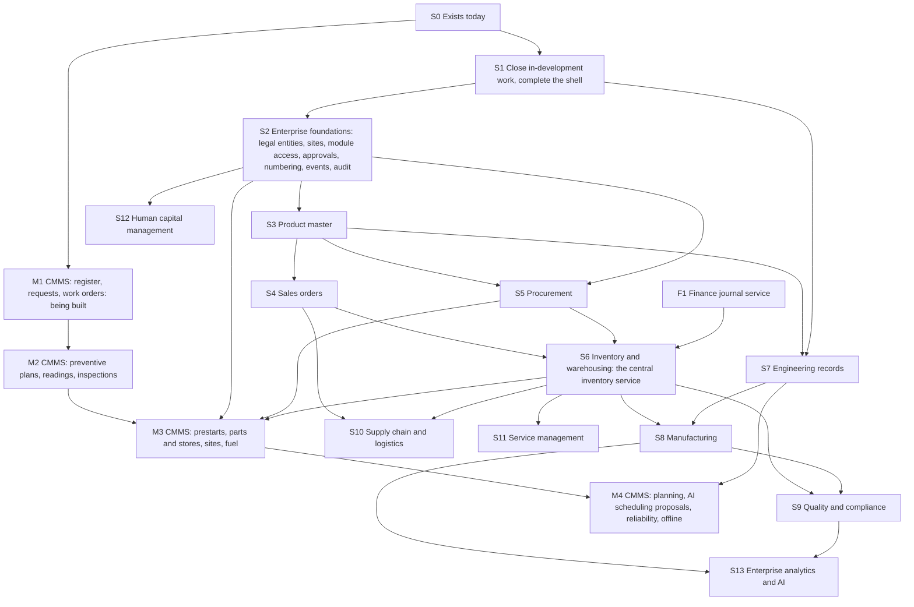

# 15. BIZOMAT ERP roadmap

Status: proposal for review, 14 Nov 2026. It starts from what exists today and orders the work for the sixteen
domains of `13-enterprise-capability-matrix.md`, foundations first. It updates `10-roadmap-and-dependencies.md`
(written before the ERP shell was live): where the two differ, this page applies. The shell, the module rail and the
existing apps inside it (page 10's Stage 1) are done; its My Work across tools and its search move to S1 here. No dates
are set. Each stage starts only after the owner approves the one before it.

## 1. Rules for every stage

- **One stage at a time.** Do not implement all modules at once. A stage is built, tested, reviewed by the owner and
  released before the next one starts. The exceptions are the CMMS track, which the owner started on 14 Nov 2026, and
  the small parallel tracks in section 6.
- **No new infrastructure.** No new Fly app, Machine, process group, volume, database or login system (`CLAUDE.md`,
  Deployment). Everything runs in the existing work app (`apps/work`), its one database and its one sign-in. More memory
  for the work Machine needs the owner's approval; the deploy preflight refuses any resize without it. Capacity is
  measured before S6 (`12-deployment-and-infrastructure.md`, finding F4).
- **Additive changes.** New `erp_*` and `co_*` tables and nullable columns only. Rollback is the previous image, which
  ignores the new tables.
- **Owners stay owners.** The CRM, Finance, Projects and CAD Automation stay authoritative for what they own. The ERP
  calls their services and never copies their records (`14-application-integration-map.md`).
- **Honest status.** A planned module is never shown as working. A stage's features move to live in
  `src/data/erp-capabilities.ts` only when its exit criteria pass and its public address is checked
  (`13-enterprise-capability-matrix.md`, section 4).
- **Every stage ends the same way:** its tests pass on both runtimes (workerd and Node) with the existing suites
  unchanged (T-REG); a browser journey passes on desktop and phone; the owner reviews it; it is released with
  `bizomat-deploy.yml` (`confirm` = `DEPLOY`); the live checks in `CLAUDE.md` pass. Test codes are defined in
  `13-enterprise-capability-matrix.md`, section 1.3.

## 2. Starting point (S0, done)

Live or connected today (64 live, 10 connected features): the ERP workspace at `/erp` with its module rail, companies
(registered and own), people, roles, departments in every tool, the platform console, the CRM, Finance (ledger,
quotes, invoices, credit notes, bills, purchase orders, banking by statement import, budgets, GST and BAS worksheet,
reports), Projects (planning, schedules, baselines, budgets, time, documents, dashboards), CAD Automation for
engineers, the ten links between them, the reports hub and the administration hub.

In development (12): CAD computers and jobs in the ERP, Sign in with BIZOMAT for CAD Automation, and CMMS Stage M1.

## 3. Order and dependencies

The order follows the owner's direction: master data and the company structure (S2), products (S3), sites and approvals
(S2), sales orders (S4), procurement (S5), inventory (S6), then manufacturing (S8), quality (S9), maintenance (the M
track), supply chain (S10), service (S11), human capital (S12) and analytics (S13). Engineering records (S7) sit before
manufacturing because work orders need BOMs and routings.

## 4. Stages

### S1. Close in-development work and complete the shell

- **Scope:** CAD Automation's status reporter and Sign in with BIZOMAT merged in CAD Automation's repository and synced;
  the CAD computers page showing live reports; My Work across Projects tasks, CRM follow-ups and Finance approvals
  (read, each source's own permissions); universal search across the tools (each module's own search, merged results);
  a notification centre reading each tool's notifications; a first screen chosen by role from existing data.
- **Prerequisites:** the owner creates the `cad` client secret, sets it on `cados` and its SHA-256 in
  `WORK_BIZOMAT_ID_CLIENTS` on `bizomat` (`docs/company/README.md`). Merging in CAD Automation's repository deploys
  `cados` automatically.
- **Tests:** `system.test.ts` extended (reports matched by account id or confirmed email; owner, administrator,
  member, guest and outsider scopes); T-ISO and T-PERM for search and My Work; T-E2E; T-HON (the page says "reporting"
  only when it is configured).
- **Exit criteria:** a paired computer appears in the ERP for its company's owner and administrators and for its own
  person, and for nobody else; a CAD Automation user signs in with BIZOMAT and keeps their connectors and computers;
  search and My Work show only what the person may see. Registry: the two CAD rows become live.
- **Not included:** new ERP records.

### S2. Enterprise foundations

- **Scope:** legal entities (a company's first one mirrors the company); sites and branches with site access; module
  access levels and role templates (`07-roles-and-permissions.md`); an approval engine with amount limits and
  segregation of duties (nobody approves their own request); numbering per company and record kind; the event outbox
  and its processor in the 15-minute run (track I1); one audit view across the systems; company policies; access
  reviews; cost centres offered across the tools. S2.2: subsidiaries.
- **Prerequisites:** S1. CMMS M1 records move onto sites and the approval engine when this stage lands, without changing
  who owns them.
- **Tests:** T-ISO, T-PERM (every module level, site scope, self-approval refused), T-DUP (idempotent event handlers),
  T-MIG.
- **Exit criteria:** an administrator creates a site and a legal entity, sets module levels and an approval rule with a
  limit; a request over the limit goes to the right approver and the requester cannot approve it; the audit view shows
  rows from every system, filtered by the reader's rights.

### S3. Product master

- **Scope:** products, classification, units and conversions, variants and configurations, specifications, lifecycle
  status, the revision field, documents; a once-only, owner-started link of the CRM's products; a product on Finance
  document lines (additive `product_id`).
- **Prerequisites:** S2 (numbering, module access).
- **Tests:** T-ISO, T-OWN (CRM products linked, never copied, renamed or deleted), T-DUP (one code per company; linking
  twice returns the same product), T-MIG.
- **Exit criteria:** a product made in the ERP appears in the CRM catalogue and on a Finance invoice line; every CRM
  product is linked once.

### S4. Sales orders

- **Scope:** sales orders from accepted quotes and won deals; order management; price lists and pricing rules; credit
  limits and holds that read Finance's receivables; invoicing from orders through Finance (services and non-stock lines
  first); order events on the CRM timeline without amounts. S4.2: sales contracts and rebates.
- **Prerequisites:** S3; Finance quotes and the one customer record (both exist); the event outbox (S2).
- **Tests:** T-ISO, T-OWN, T-DUP (one order per accepted quote unless split on purpose), T-QTY (never invoiced beyond
  what was ordered or delivered), T-LED, T-E2E (flow 4.1 of page 14 up to the invoice).
- **Exit criteria:** quote to order to draft invoice in Finance; the deal's timeline shows the order; voiding the
  invoice releases the invoiced quantity.

### S5. Procurement

- **Scope:** supplier profiles and qualification (keyed by the Finance contact); requisitions with approval; requests
  for quotation and supplier comparison; purchase orders through Finance with product lines and expected dates
  (purchase scheduling); the project procurement link (track P3). S5.2: supplier contracts.
- **Prerequisites:** S2 (approvals), S3 (products), Finance purchase orders (exist).
- **Tests:** T-PERM (self-approval refused), T-OWN (the purchase order stays a Finance document), T-DUP, T-E2E.
- **Exit criteria:** an approved requisition becomes a purchase order numbered by Finance, with its expected dates in
  the ERP.

### S6. Inventory and warehousing (the central inventory service)

- **Scope:** warehouses, bins and locations per site; the stock move ledger and stock on hand; goods receipts against
  purchase orders; three-way matching on bill approval; transfers between locations and sites; reservations; backorders;
  cycle counts with approval; valuation journals through Finance; picking, packing, dispatch and deliveries from stock;
  returns. S6.2: lots, serial numbers, barcodes and QR scanning, replenishment. Every other module (sales,
  manufacturing, maintenance, service) moves stock only through this service.
- **Prerequisites:** S3, S4, S5; track F1; capacity measured on the work Machine, and the owner's approval if it needs
  more memory.
- **Tests:** T-QTY, T-LED, T-DUP (idempotency keys for scanners), T-E2E (receiving on a phone); the journey of
  `11-testing-and-migration-strategy.md` section 11.2.
- **Exit criteria:** that journey passes (receive 10, deliver 4, 6 on hand, journals with their origin, trial balance
  balanced, no second order from the same quote); the CMMS track can reserve, issue and return parts through the
  service.

### S7. Engineering records

- **Scope:** bills of materials (multi-level, compare, where-used); routings and work centres; revisions and release;
  engineering change requests and orders with approval; document control; CAD links by hand; Create drawing through
  CAD Automation, acting for the engineer. S7.2: product costing.
- **Prerequisites:** S3, S2 (approvals), S1 (Sign in with BIZOMAT for generated drawings).
- **Tests:** T-ISO, T-PERM, T-DUP, T-CAD (the engineer's token, command status, exports fetched before their links
  expire).
- **Exit criteria:** revision C released by an ECO with its PDF and DXF kept in the ERP; revision B superseded; nothing
  kept at CAD Automation beyond its own command history.

### S8. Manufacturing

- **Scope:** production orders (discrete, make to stock, make to order, engineer to order, project manufacturing);
  release with availability and reservations; job management; shop-floor control on tablets; labour and machine
  tracking; issues and outputs; work in progress and its journals; scrap and rework; production costing; capacity
  planning; tasks in Projects per operation. S8.2: master production scheduling, MRP, advanced planning and scheduling,
  MES, OEE, process and repetitive manufacturing.
- **Prerequisites:** S6, S7.
- **Tests:** T-QTY, T-LED, T-OWN (tasks through Projects' service), T-E2E (tablet).
- **Exit criteria:** an order for 4 releases a work order, reserves components, reports its operations, outputs 4 to
  stock, clears work in progress, and its Projects tasks close.

### S9. Quality and compliance

- **Scope:** quality plans; incoming inspection with quarantine; in-process and final inspection; nonconformance reports
  with disposition and approval; corrective and preventive actions with tasks in Projects; calibration (instruments
  are CMMS assets); quality audits; traceability; supplier quality; product and engineering compliance; quality
  reporting. Governance: risk management, policy management, regulatory records, document retention. S9.2: statistical
  process control.
- **Prerequisites:** S6 (receipts; lots in S6.2), S8 (operations), CMMS M1 and M2 (assets and plans for calibration).
- **Tests:** T-QTY (quarantined stock cannot be issued), T-PERM (disposition approval), T-OWN.
- **Exit criteria:** a failed incoming inspection raises one draft NCR and the stock stays in quarantine until its
  disposition is approved.

### S10. Supply chain and logistics

- **Scope:** carriers; shipments with tracking references and freight cost; the delivery schedule; landed costs;
  distribution; demand and supply planning. S10.2: inventory optimisation. Connections to carriers are an owner
  decision with their own security review.
- **Prerequisites:** S4, S6; F1 for landed cost journals.
- **Tests:** T-LED, T-ISO, T-E2E.
- **Exit criteria:** a shipment records its carrier, reference and freight; landed cost is spread over the receipt with
  a journal.

### S11. Service management

- **Scope:** cases linked to CRM companies; service contracts; warranty by serial number; service orders; field service
  (reusing the CMMS technician screens); repairs; return material authorisation; spare parts from inventory; service
  history. S11.2: technician scheduling (reusing CMMS M4 planning).
- **Prerequisites:** S4, S6 (serials in S6.2), CMMS M1 (and M4 for scheduling).
- **Tests:** T-ISO, T-OWN (the CRM stays the customer record), T-QTY.
- **Exit criteria:** a case becomes a service order, parts are issued, the repair is recorded, and the history shows
  per customer and serial number.

### S12. Human capital management

- **Scope:** employee records linked to company members; positions and reporting lines; onboarding; training;
  qualifications (which feed CMMS trades); leave with approval. S12.2: recruitment, workforce scheduling, attendance,
  performance. **Payroll and superannuation are not in this stage.** They belong to Finance's own Stage 4 (track F4)
  and need an approved design and provider; BIZOMAT does not run payroll today.
- **Prerequisites:** S2 (legal entities, approvals).
- **Tests:** T-ISO, T-PERM, a personal data review (only the fields needed; exports audited), T-HON.
- **Exit criteria:** an employee record exists for a member; a leave request is approved by their manager; a
  qualification shows on a technician in CMMS planning.

### S13. Enterprise analytics and AI

- **Scope:** role dashboards and the widget catalogue (`../ux/04-role-dashboards.md`); operational KPIs; production
  analytics; saved and scheduled reports; exception detection; predictive forecasting; an AI business assistant over the
  records the person may see; natural-language reporting; controlled AI actions (a proposal, a preview, an explanation,
  a person's approval, a history); workflow automation across systems (with track I2).
- **Prerequisites:** the modules whose figures it shows; S2 (approvals); I1 (events).
- **Tests:** T-AI, T-ISO, T-PERM (the assistant reads through each owner's permissions), T-HON (forecasts labelled as
  estimates).
- **Exit criteria:** every dashboard figure opens the list behind it; the assistant answers only from records the
  person may see; no AI action changes a record without a person's approval.

## 5. Asset management and maintenance (CMMS track)

Owner's brief, 14 Nov 2026: a full maintenance management system inside BIZOMAT ERP, with MEX as a functional
reference only (no branding, design or text copied). Four stages. M1 is being built now; its features are
in-development in the registry until its exit criteria pass, then the lead marks them live.

| Stage | Scope | Prerequisites | Tests | Exit criteria |
| --- | --- | --- | --- | --- |
| M1 (built, released with the Systems pages: `apps/work/src/worker/maintenance/`, `mt_*` tables in migration `0018_maintenance.sql`) | Asset register and hierarchy; asset details; maintenance requests with approval; standard work orders (corrective, breakdown and other job types) with tasks, required parts as text and notes; maintenance roles (administrator, supervisor, technician, requester); technician assignment; labour timer; photos and documents; a history of every change; the technician's phone screens | S0 (company tenancy, sign-in, file store). Sites and the approval engine come in S2; M1 moves onto them then | T-ISO, T-PERM (the four maintenance roles), T-DUP, T-MIG, T-E2E (phone); one running timer per person and work order; sandboxed downloads | The owner's acceptance tests A to J that apply to M1; registry M1 rows live; the maintenance card on the Operations page shows its real state; public address checked |
| M2 | Preventive plans triggered by time, usage or condition; maintenance calendar; recurring work orders; readings with thresholds and trend charts; threshold alerts; inspections across several assets (pass, fail, observation, not applicable, number, text, photo, signature) where a failed answer raises a request or work order by rule; shutdown projects in Projects; first part of the administration centre (categories, job types, priorities, templates) | M1 | T-DUP (one work order per due trigger, one request per failed answer, one alert per crossing), T-OWN (tasks through Projects' service), T-E2E | The owner's acceptance tests A to J that apply to M2 |
| M3 | Digital prestart checklists; spare parts and stores through ERP Inventory and Procurement (minimum and maximum, reorder points, reservations, issues and returns to work orders); stocktakes with approval through the central inventory service; barcode and QR scanning; multi-site maintenance; fuel records; work order costs to Finance (labour allocation, parts issues, contractor bills that reference the work order) | M2; S2 (sites, approvals); S5 (requisitions); S6 (inventory service; barcodes in S6.2); F1 (journal service) | T-QTY, T-LED, T-OWN (no maintenance stock table), T-PERM, T-E2E (scanning on a phone) | The owner's acceptance tests A to J that apply to M3 |
| M4 | Trades and technician workload planning; the AI scheduling assistant (it proposes only: preview, explanation, manual edit, accept or reject, history, comparison); reliability reporting (mean time between failures and to repair, failure frequency, downtime, preventive maintenance compliance, repeat failures, cost by asset and department, exports); downtime; predictive maintenance; IoT integrations; offline field operation; lifecycle costs; drawings and manuals from Engineering; the rest of the administration centre (custom and mandatory fields, labels, approval rules, field-level edit rights, audit of configuration changes) | M3; S7 (drawings); I1 and I2 (events, scoped tokens for devices); the controlled AI action rules (built once, by whichever of M4 and S13 comes first); F3 (fixed asset references) | T-AI, T-OFF, T-LED, a security review for device connections | The owner's acceptance tests A to J that apply to M4. Offline operation is never claimed until T-OFF passes: offline queue, reconnection, conflict resolution and audit |

If the owner wants M3 before S5 and S6, the inventory core is built first as the shared service (a narrower S6 for
parts and stores), never as a separate maintenance stock table.

### 5.1 The owner's acceptance tests A to J

The owner's CMMS brief (14 Nov 2026, section 19) names acceptance tests A to J as the exit criteria of the stages
above. Their wording, from the brief, and the stage each test closes. M1's tests are automated in
`apps/work/test/maintenance.test.ts`.

| Test | Wording (from the owner's brief) | Closes stage |
| --- | --- | --- |
| A | Create an asset hierarchy and register a machine with manufacturer, model and serial number. | M1 |
| B | An employee raises a maintenance request with a photograph. A supervisor approves it and creates a work order. | M1 |
| C | Create a work order with instructions, tasks, labour requirements and spare parts. | M1 (parts as required lines; issuing from stores in M3) |
| D | Technician starts timer, records work, issues parts, uploads photographs and completes the work order. | M1 (timer, work, photographs, completion); M3 (issuing parts) |
| E | Create a preventive plan based on operating hours. Enter a new asset reading beyond the threshold. Verify the correct maintenance trigger and work order. | M2 |
| F | Complete a multi-asset inspection. Fail one inspection question. Verify an appropriate maintenance action is raised. | M2 |
| G | Complete a prestart checklist. Fail a safety check. Verify the asset warning and maintenance request. | M3 |
| H | Perform a stocktake with barcode or manual item search. Approve and process the stocktake. Verify the central inventory quantity updates. | M3 |
| I | Generate maintenance cost and asset reliability reports. | M4 |
| J | Verify access restrictions across two organisations and multiple maintenance roles. | M1, and again at every later stage |

## 6. Parallel tracks

Small tracks that run beside the stages when a stage needs them.

| Track | Scope | Needed by | Rules |
| --- | --- | --- | --- |
| F1 Finance journal service | Additive `fin_journals.origin`; a `postJournal` service over `journalStmts`; Inventory, goods received not invoiced and work in progress accounts added on first ERP use | S6, S8, S10, M3 | T-LED, T-MIG; the ledger triggers keep applying |
| F2 Finance Stage 2 (its own brief) | BAS module with lodged-period snapshots; PAYG instalments | - | BIZOMAT does not lodge; the worksheet and snapshots support the business or its agent |
| F3 Finance Stage 3 (its own brief) | Bank feeds through an approved provider; fixed assets (asset accounting, linked to CMMS assets); management reporting. Its "inventory" item is the valuation path of S6, not a second stock ledger | M3, M4 (fixed asset references) | A bank provider is the owner's decision with a security review |
| F4 Finance Stage 4 (its own brief) | Payroll and Single Touch Payroll, superannuation, multi-currency, ATO Standard Business Reporting | S12 (payroll stays here) | Each needs an approved design and provider; never claimed before |
| F5 (proposed) | Intercompany transactions, consolidation, treasury, cost accounting, profitability by product and customer, planning scenarios | - | After S2 (legal entities) and F4 (multi-currency) |
| I1 Events | Event outbox processing; integration monitoring | S2, S4 onwards | Idempotent handlers; identifiers only in events, never personal data or amounts beyond what the receiver may see |
| I2 Platform | Published API reference; scoped API tokens; webhooks from every module; custom fields on ERP records; workflows across systems; a report designer | M4 (devices), S13 | Same permission checks as the screens |
| I3 Exchange | EDI and e-invoicing | After S4 and S5 | A provider is the owner's decision |
| P1 Projects | Portfolios; timesheet approval | After S2 | Projects stays the owner of projects and tasks |
| P2 Projects | Project billing from time or milestones | After S4 | Invoices through Finance only |
| P3 Projects | Project procurement | After S5 | Purchase orders through Finance only |

## 7. Domains and their stages

| # | Domain | Today | Stages |
| --- | --- | --- | --- |
| 1 | Enterprise management | Live core (companies, people, roles, departments, console) | S2 (entities, sites, policies), F5 (intercompany), F4 (multi-currency) |
| 2 | Finance and controlling | Live (ledger, payables, receivables, cash by statement import, budgets, GST worksheet, reports) | F1 to F5 |
| 3 | Sales and distribution | Live CRM and quotes, connected to invoices | S4, S6 (deliveries from stock, returns), S11 |
| 4 | Sourcing and procurement | Live Finance suppliers, purchase orders and bills | S5, S6 (receipts, matching) |
| 5 | Product lifecycle and engineering | Live CAD Automation; CAD status in development | S1, S3, S7 |
| 6 | Manufacturing | Planned | S8 |
| 7 | Inventory and warehousing | Planned | S6 |
| 8 | Supply chain and logistics | Planned | S6, S8.2, S10 |
| 9 | Quality management | Planned | S9 |
| 10 | Asset management and maintenance | M1 live | M2 to M4 |
| 11 | Project and portfolio management | Live Projects, connected to CRM and Finance | P1 to P3 |
| 12 | Service management | Planned | S11 |
| 13 | Human capital management | Live departments only | S12 (payroll in F4) |
| 14 | Governance and compliance | Live Finance controls, audit trails, data security | S2, S9 |
| 15 | Enterprise analytics and AI | Live reports hub, connected dashboards | S1, S13 |
| 16 | Enterprise integration platform | Live APIs, webhooks, identity; CAD sign-in in development | S1, I1 to I3 |

## 8. What can change the order

- A business that only trades can skip S7 and S8 and still use S4 to S6.
- If the owner wants CMMS parts and stores early, the inventory core moves forward (section 5).
- If CAD Automation's sign-in is delayed, S7 still releases with CAD links by hand; Create drawing waits.
- Measured capacity on the work Machine may require the owner to approve more memory before S6; nothing is resized
  without that approval.
